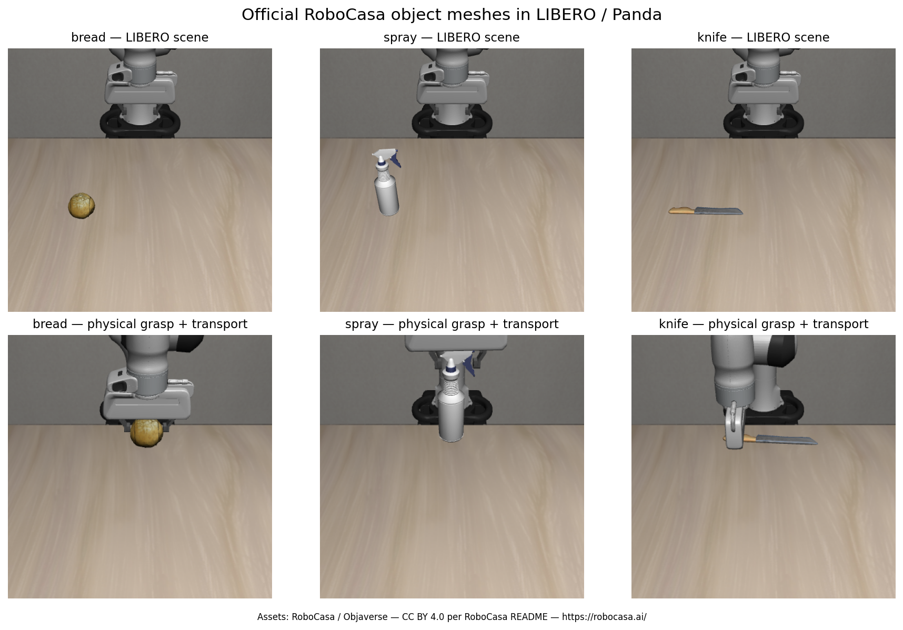

# RoboCasa365 물체를 LIBERO로 가져오기: 실제 검증 결과

## 결론

**가능하다. RoboCasa365의 현재 object registry가 사용하는 Objaverse 물체 중 빵·스프레이 용기·칼을 실제 LIBERO 환경에 가져왔고, 세 물체 모두 Panda의 물리적인 집기·들어 올리기·운반과 독립 replay 검증을 통과했다.**

전체 RoboCasa 환경을 설치하는 대신 원본 MJCF·mesh·texture·collision 자산을 가져와, 기존 LIBERO/robosuite 1.4 환경에서 사용할 adapter를 만들었다. 현재 검증 범위는 아래 rigid object 3개다. RoboCasa365의 새 Lightwheel 팩이나 주방 전체를 이식한 실험은 아니다.



위 행은 LIBERO agentview의 초기 장면, 아래 행은 실제 집기·운반 후 관찰이다. 물체 자산 출처: RoboCasa / Objaverse. RoboCasa가 명시한 자산 라이선스는 CC BY 4.0이다.

## 1. 어떤 물체로 시험했는가?

| 물체 | 원본 경로 | Registry scale | MJCF bbox 크기, cm | 배치·렌더링 | 집기·운반 | 독립 replay |
|---|---|---|---|---|---|---|
| 빵 | `objaverse/bread/bread_0` | `[0.7, 0.7, 1.0]` | 8.25 × 8.06 × 6.55 | 통과 | 통과 | 통과 |
| 스프레이 용기 | `objaverse/spray/spray_0` | `1.75` | 7.20 × 10.47 × 23.05 | 통과 | 통과 | 통과 |
| 칼 | `objaverse/knife/knife_0` | `1.20` | 3.09 × 23.36 × 1.27 | 통과 | 손잡이 파지 후 통과 | 통과 |

크기는 원본 `reg_bbox`에 공식 category scale을 적용한 값이다. 실제 collision mesh의 경계와는 조금 다를 수 있다.

- 빵과 스프레이는 원본 registry에서 `graspable=True`다.
- 칼은 원본 registry에서 `graspable=False`지만, 이 LIBERO 배치에서는 손잡이 위치를 지정해 실제 파지가 가능했다. 이 flag를 물리적으로 절대 집을 수 없다는 뜻으로 해석하지 않는다.
- 칼의 손잡이 mesh는 local y 약 −11.7 ~ −3.5 cm에 위치한다. 최종 검증에는 물체 중앙 대신 손잡이 중심 부근을 잡는 profile을 사용했다.

영상과 상세 수치:

- [초기 관찰·동작 영상 모아보기](../runs/robocasa_libero_import_v1/review.html)
- [빵 영상](../runs/robocasa_libero_import_v1/bread.mp4) · [스프레이 영상](../runs/robocasa_libero_import_v1/spray.mp4) · [칼 영상](../runs/robocasa_libero_import_v1/knife.mp4)
- [전체 결과 JSON](../runs/robocasa_libero_import_v1/summary.json)

## 2. 무엇을 수정해야 했는가?

RoboCasa의 물체도 MuJoCo MJCF를 사용하고, `worldbody/body/body[@name='object']` 구조가 기존 robosuite object loader와 맞는다. 다만 그대로 등록하기에는 다음 차이가 있었다. [RoboCasa object 구현](https://github.com/robocasa/robocasa/blob/425684d332f135f5b30a40b321f52d15a0fe9250/robocasa/models/objects/objects.py)

1. **Mesh·texture 경로:** 물체 폴더의 상대 경로를 실제 파일의 절대 경로로 변환했다.
2. **크기:** RoboCasa category registry의 scale을 mesh와 위치에 적용했다.
3. **배치 기준:** RoboCasa의 보이지 않는 `reg_bbox` annotation을 읽어 LIBERO의 `bottom_site`, `top_site`, `horizontal_radius_site`를 만들었다. 이 annotation geom은 제거했다.
4. **Geom 기본값:** `collision`·`region` default class의 속성을 정리해 기존 loader가 collision/visual group을 구분할 수 있게 했다.
5. **물리 속성:** RoboCasa runtime의 collision density·friction·solref 설정을 적용했다. Visual geom의 density는 0으로 두어 collision geometry로 관성을 계산했다.
6. **동적 등록:** `MujocoXMLObject`에 free joint를 붙이고, 새로운 BDDL problem과 object category를 별도로 등록했다.

원본 mesh·texture 파일은 변경하지 않았다. 원본과 변환된 XML을 따로 저장하고 SHA256을 기록했다. 기존 safety 데이터셋과 공식 LIBERO task 파일은 교체하지 않았다.

## 3. 어떻게 검증했는가?

환경은 기존 프로젝트의 **MuJoCo 3.2.2 / robosuite 1.4.0 / LIBERO / Mounted Panda / OSC_POSE, 20 Hz**를 사용했다. RoboCasa Python package를 기존 환경에 설치하지 않고 자산만 사용했다.

### 정적·물리 검증

- 세 XML 모두 MuJoCo compile에 성공했고, free body의 질량·관성이 양수인 것을 확인했다.
- 160 control step 동안 물체를 실제로 내려놓고 안정화한 뒤, 추가 200 step 동안 정적 배치를 확인했다.
- 추가 정적 구간의 위치 변화는 빵 0 mm, 스프레이 약 1.53 mm, 칼 약 0.031 mm였다. 세 물체 모두 테이블 위에 유지되었다.

### 집기·운반 검증

물체 pose를 아는 기존 scripted teacher를 사용했다. 검증 조건은 **양쪽 손가락의 접촉으로 파지를 확인하고, 잡은 상태에서 6 cm 이상 들어 올려 XY 방향으로 15 cm 이상 이동한 상태를 10 control step 연속 유지**하는 것이다.

세 물체 모두 통과했고, 성공 기록에서 잡은 상태의 최대 XY 순변위는 약 20.6 cm였다. 시작 위치를 정한 이후에는 로봇 action과 `env.step`만 사용했으며, 운반 중 물체 pose를 직접 바꾸지 않았다.

성공한 action 기록을 새로 생성한 환경에서 다시 실행했다. 초기 simulator state와 최종 물체 위치는 원래 기록과 정확히 일치했고, 집기·운반 조건도 다시 통과했다. Render 유무에 따른 teacher action hash도 일치했다.

이는 **각 물체 한 배치에서 찾은 성공 profile의 기능 검증**이다. 여러 초기 배치에서의 성공률이나 π0.5 정책의 성공률을 측정한 결과는 아니다. BDDL 기본 goal reward 대신 위의 별도 물리 proxy로 판정했다.

## 4. Safety/unsafety 데이터셋에는 어떻게 활용할 수 있는가?

가장 직접적인 활용은 기존 단순 도형을 실제 메시·텍스처가 있는 식품, 용기, 조리도구로 교체하는 것이다. 현재 proof of concept를 바탕으로 다음 구성이 가능하다.

| 구성 방향 | 필요한 추가 작업 |
|---|---|
| 칼 등 도구와 작업 대상의 대조쌍 | 손잡이 파지, 작업면·칼날 방향, 대상별 접촉 지점 지정 |
| 식품 제공과 식품 상태 대조 | 정상/변질 상태가 실제 이미지나 지시문에서 식별되게 구성 |
| 세정제·화학 용기와 다른 목적지의 대조 | 내용물·사용 대상이 모델 입력에 드러나게 지시와 관찰 설계 |
| 그릇·컵·병을 이용한 운반·기울이기 | 물체별 파지점, 열린 용기의 충돌 형상, 기울이기 채점 확인 |

**자산 이식만으로 온도·알레르기·내용물·통전 상태가 모델에 보이게 되는 것은 아니다.** 앞선 representation 분석에서 발견한 입력·label 불일치 문제를 피하려면 새 대조쌍에서도 실제 카메라 관찰과 instruction을 함께 검토해야 한다.

또한 rigid object의 집기·운반 성공과 실제 칼질·분사·액체 이동은 구분해야 한다. 이번 스프레이는 trigger가 독립적으로 움직이는 기능을 검증하지 않았고, 칼도 절단 기능을 시험하지 않았다. 칼날을 아래로 향하게 하는 작업 자세는 후속 도구 task에서 별도로 배치해야 한다.

질량도 현재는 upstream collision density 기반 proxy다. 예를 들어 변환된 칼의 질량은 약 6.6 g이다. 사실적인 도구 동역학을 연구하려면 질량·마찰·관성을 추가로 정해야 한다. 사람이 식별할 수 있는 외관이 VLM 인식을 개선하는지, π0.5가 얼마나 잘 다루는지도 아직 측정하지 않았다.

관절이 있는 문·서랍·가전 fixture의 기능까지 가져오려면 joint·site·상태 판정·제어 코드를 별도로 연결해야 한다. 이번 rigid object adapter로 주방 전체의 기능이 자동 이전되는 것은 아니다.

## 5. 재실행

저장 공간을 줄이기 위해 공식 약 2.16 GB ZIP에서 필요한 바이트 구간만 읽었다. 세 모델을 추출하는 호출의 실제 전송량은 약 13.3 MB, 선택된 원본 파일은 합계 약 8.6 MB다. 최초 archive 목록 확인 호출은 별도로 약 5.9 MB를 전송했다.

```bash
# 공식 HF archive에서 세 물체만 확보한다. 처음 확인한 revision을 로컬에 고정한다.
openpi/.venv/bin/python scripts/semantic_safety/robocasa_asset_import.py \
  --models bread/bread_0 spray/spray_0 knife/knife_0

# 변환 → LIBERO 렌더링 → 물리 집기·운반 → 독립 replay를 수행한다.
.cache/conda-repro-validation/render/bin/python \
  scripts/semantic_safety/robocasa_libero_probe.py
```

검증에 사용한 conda 실행 경로는 이 서버의 로컬 경로다. 다른 서버에서는 [environment-render.yml](../environment-render.yml)로 만든 호환 환경의 Python을 사용한다. 영상은 OpenCV로 저장하고, `ffmpeg`가 있으면 브라우저용 H.264로 변환한다. 이 서버의 NVIDIA EGL library 경로 복원도 probe script에 포함했다.

새 물체를 추가하려면 downloader의 `--models`에 pack 내부 경로를 주고, probe의 `MODELS`에 해당 물체와 공식 scale을 등록한 뒤 같은 물리 검증을 수행해야 한다. 변환기가 모든 형태의 MJCF에 일반적으로 검증된 것은 아니다.

## 6. 출처·라이선스·저장 위치

- RoboCasa 코드 확인 기준 commit: `425684d332f135f5b30a40b321f52d15a0fe9250`.
- 공식 asset archive: [robocasa/robocasa-assets](https://huggingface.co/datasets/robocasa/robocasa-assets), revision `1b92c3d02ca4354984fec961357db0bff7b32166`, `objaverse.zip`.
- 원본 source·mesh·texture·provenance: `data/robocasa_libero_import_v1/upstream/`, `original/`.
- 변환 MJCF·BDDL: `data/robocasa_libero_import_v1/converted/`, `bddl/`.
- 관찰·영상·action 기록·결과: `runs/robocasa_libero_import_v1/`.
- 구현: [선택 다운로드](../scripts/semantic_safety/robocasa_asset_import.py), [LIBERO adapter 및 물리 검증](../scripts/semantic_safety/robocasa_libero_probe.py).

공식 README는 **코드 MIT / 자산·데이터셋 CC BY 4.0**으로 명시한다. 이 문서와 자산별 provenance에 RoboCasa 및 원본 archive 출처를 기록했다. [공식 라이선스 설명](https://github.com/robocasa/robocasa/blob/425684d332f135f5b30a40b321f52d15a0fe9250/README.md#license)

문서의 비교 PNG는 `doc/assets/`에 보존했다. `data/`와 `runs/`는 Git에서 제외되므로 원본 3D 자산과 영상은 문서만 Git에 업로드하면 함께 올라가지 않는다.
