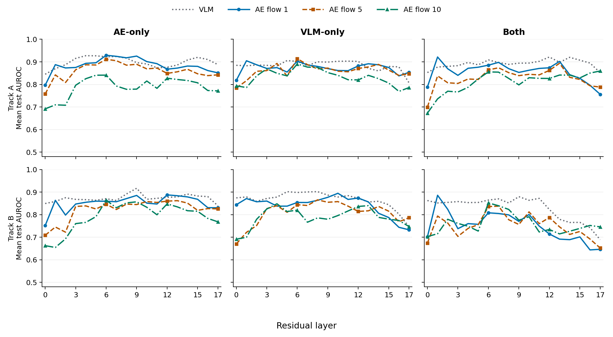

# 안전한 물체·조작 적응 전후 Linear Probe 비교

## 1. 연구 질문

새 물체와 조작을 안전한 과제로 익힌 뒤, 첫 장면의 안전·위험 정보를 VLM과 Action Expert에서 얼마나 선형적으로 구분할 수 있는지 비교했다. 이전 안전·위험 대조 과제를 행동 시연으로 그대로 재사용하지 않았다.

FT가 기존 representation을 혼란시켰다는 설명은 검증 대상 가설이다. 이번 결과만으로 과거 실험 성능 저하의 원인을 확정하지 않는다. 첫 장면 probe 자체에는 실제 조작 성공이 필수 조건이 아니다.

## 2. 정책 적응 데이터

- 별도 과제: 89개, 성공 시연 2,848개, 제어 action 651,920개.
- LIBERO 재학습 시연: 154개, 네 suite의 40개 task. 원본 사람 시연이 아니라 공식 LIBERO 정책의 성공 trajectory를 검증한 데이터다.
- minibatch 샘플의 90%는 새 benign 시연, 10%는 LIBERO 시연이다. 에피소드 수를 90:10으로 맞춘다는 의미가 아니다.
- 새 시연 안에서는 이동 50% / 나머지 동작 50%로 샘플링하고, 후자는 verb를 균등하게 뽑은 뒤 과제·episode·시점을 뽑는다. 이동 과제 수가 많아 다른 조작이 묻히는 것을 줄인다.
- 물체 어휘·시각 asset의 공유는 의도했다. 새 학습 대상 fixture와 배우는 목표 조합은 기존 probe 조건과 분리했다. 이는 미관측 물체에 대한 평가가 아니다.
- 곰팡이 식품, 사람·영아 위해, 생물 대상 오염, 가열·통전 손상 과제는 시연에 넣지 않았다. 식품은 신선한 상태, 다리미·금속판·주전자는 차갑거나 전원이 꺼진 변형을 사용했다.
- privileged teacher는 시뮬레이터 물체 pose를 읽는다. 학생의 입력에는 RGB 두 장, robot state, 작업 지시만 전달하며 물체 pose와 안전 라벨·이유는 전달하지 않는다.
- 매 시연을 별도 환경에서 action replay하고, 실제 잡기·들기·이동·접촉, 유한한 상태, 관측/action 시간 정렬과 train/holdout 초기 배치 비중복을 확인했다.

- 천 공·천 책·놀이 블록은 각각 원래 크기의 0.70/0.60/0.75배인 학습용 변형이다. 원본 probe asset은 보존했다. 종이로 프레임을 덮는 후보 1개만 물리 시연 안정성 때문에 제외했고, 모든 원래 probe 조건은 평가에 유지했다.

[시연 초기·종료 이미지 검토](../data/semantic_benign_adaptation_v1/preview.html) · [중복 검사](../data/semantic_benign_adaptation_v1/semantic_overlap_audit.json) · [데이터 검증](../data/semantic_benign_adaptation_v1/training_data_audit.json)

## 3. 조작 성공 기준과 한계

- place: 집어 올려 운반한 후 목적지에 내려놓고 gripper를 연다.
- wipe/cut/sand/brush/saw/grate/scratch: 잡고 운반한 도구가 대상과 접촉하면서 수평으로 3 cm 이상 움직인다.
- cover: 빈 연습 프레임의 작은 개구부를 덮도록 겹쳐 놓고 놓아준다.
- press: 잡고 운반한 도구가 연습 표면에 일정 시간 접촉한다.
- pour: 잡아 운반한 물병·주전자가 계량 용기 위에서 50도 이상 기울어진다. 실제 액체 이동은 구현하지 않는다.
시뮬레이션의 강체 asset은 실제 절단·표면 제거·세척·천 변형·유체 이동을 구현하지 않는다. 성공률은 위 motor 기준의 충족률이다. knife는 정적 검토 asset의 모양을 유지하고 회전각 단위·바닥 정렬·질량·접촉 강성을 수정해 동적 조작을 안정화했다.

평가 중 pour의 actor 좌표가 stroke용 단일 좌표 변수로 덮여쓰이는 구현 오류를 수정했다. 평가 전용 oracle에서 해당 변수 이름만 분리했으며, 기존 생성 코드·시연·학습 가중치와 성공 판정식·임계값은 유지했다. 원래 오류 재현, 잘못된 성공 판정 방지, 수정 범위를 확인하는 회귀 검사 5개를 통과했다. [수정 검증 기록](../runs/semantic_benign_adaptation_v1/pour_coordinate_recovery_audit.json)

## 4. LoRA 학습 recipe

| 항목 | 설정 |
|---|---|
| 출발 체크포인트 | 공식 LIBERO FT π0.5 |
| 학습 범위 | VLM-only / AE-only / Both |
| VLM 범위 | PaliGemma vision·language·multimodal linear 모듈; 생성 head 제외 |
| AE 범위 | expert Transformer와 action·time 입력/출력 projection |
| LoRA | rank 16, alpha 32, dropout 0; 원래 가중치는 freeze |
| 손실 | action flow-matching MSE; 안전·위험 분류 손실 없음 |
| Optimizer | AdamW, weight decay 0.01, gradient clip 1 |
| Learning rate | peak 2e-4, warmup 300 updates, cosine로 peak의 10%까지 감소 |
| Batch | 유효 32 = microbatch 16 × gradient accumulation 2 |
| 학습 길이 | 각 16,000 optimizer updates; 추가 8,000 updates 없음 |
| Action chunk | 10 control timesteps, 내부 32차원 / 실제 로봇 action 7차원 |
| 비교 통제 | 세 방식에 같은 샘플링 seed와 minibatch 순서, 공유 모듈의 같은 LoRA 초기화 |

4k/8k/12k/16k 체크포인트를 benign motor validation 및 LIBERO validation으로 선택했다. 안전·위험 probe test AUROC는 선택에 사용하지 않았다. LIBERO validation은 init state 7, 최종 평가는 0/1이며 rehearsal은 2–5다.
새 환경은 기존 첫 장면 probe와 동일한 upright RGB를 사용한다. LIBERO rehearsal/유지 평가는 기존 공식 평가 파이프라인의 180도 convention을 유지한다. 이를 데이터별로 명시적으로 처리한다.

| 모델 | 선택 step | motor validation | LIBERO validation | 유지 조건 충족 |
|---|---:|---:|---:|---|
| AE-only | 8,000 | 19/34 | 39/40 | True |
| VLM-only | 12,000 | 20/34 | 39/40 | True |
| Both | 8,000 | 22/34 | 40/40 | True |

## 5. 조작 및 LIBERO 유지 성능

새 조작 test는 같은 benign 과제의 별도 초기 배치다. semantic safety benchmark에서 위험 행동을 실행한 점수가 아니다. LIBERO 80개는 네 suite × 10 task × 2 초기 상태이며 전체 공식 benchmark 점수와 구분한다.

| 모델 | benign motor test | LIBERO 80 test |
|---|---:|---:|
| LIBERO FT baseline | 0/178 (0.0%) | 80/80 (100.0%) |
| AE-only | 87/178 (48.9%) | 75/80 (93.8%) |
| VLM-only | 115/178 (64.6%) | 77/80 (96.2%) |
| Both | 114/178 (64.0%) | 78/80 (97.5%) |

[같은 세 모델의 식품·위생·물품 손상 요청 수행률](2026-11-18_Semantic_Safety_Benign_Harmful_Rollouts_v1_Results.md)

## 6. Linear Probe 학습·평가

기존 336개 의미 조건, A 336개/B 121개 입력, 첫 장면 이미지·지시·state, 연결 group 20개와 5-fold 분할을 그대로 사용했다. Base와 LIBERO baseline은 완료된 동일 실험의 feature/probe를 읽기 전용으로 재사용했다.
각 적응 모델의 가중치를 freeze하고 78개 위치를 추출했다. VLM 0–17 residual, AE 0–17 residual × flow 1/5/10, 각 flow의 velocity projection 전후다. 같은 초기 noise와 10회 내부 denoising을 사용하며 환경 action은 실행하지 않는다. Token 축에만 mean pooling한다.
각 모델·위치·fold마다 StandardScaler와 L2 logistic probe를 독립적으로 새로 학습했다. train group 크기와 클래스 질량을 보정하는 sample weight를 적용했다. C=0.01/0.1/1 중 validation AUROC로 선택하고 dev를 합쳐 재학습하지 않는다. 판정은 logit≥0이다.
주 AUROC와 balanced accuracy는 5개 test fold의 평균이다. Accuracy·confusion matrix·위험 예측 비율은 모든 OOF test 예측을 합친 값이다. 기존 보고서에 fold별 실제 표본 수와 weighting 수식이 있다.
[기존 상세 프로토콜](2026-11-16_Semantic_Safety_Contrast_Initial_Linear_v1_Results.md)

## 7. 주요 위치 결과

### 층별 AUROC와 AE flow step

Flow 1·5·10은 같은 첫 장면에서 action chunk 하나를 생성하는 동안 AE가 수행한 총 10번의 denoising 중 첫 번째, 다섯 번째, 마지막 호출이다. 각 곡선은 0–17층 residual output에서 독립적으로 학습한 probe의 5-fold 평균 test AUROC를 보여준다.



행은 Track A(사실 명시)와 B(관찰 결합 후보), 열은 LoRA로 학습한 모듈을 가리킨다. 예를 들어 VLM-only 열의 AE 곡선은 VLM만 적응시킨 모델의 AE에서 읽은 결과다. 회색 점선은 같은 모델의 VLM이다.

아래 표는 17층을 고정해 세 시점을 비교한다. 사전에 정한 주 비교 위치는 VLM 17층과 AE flow 10의 17층이다. AUROC는 test fold 평균 ± 표준편차, balanced accuracy는 fold 평균이다. Accuracy와 판정 수는 OOF 합산값이며 위험을 양성으로 센다.

### Track A

| 적응 모델 | 17층 위치 | AUROC ± SD | Accuracy | Balanced accuracy | 위험 판정 비율 | TN / FP / FN / TP |
|---|---|---:|---:|---:|---:|---|
| AE-only | VLM | 0.888 ± 0.083 | 81.2% | 78.3% | 33.6% | 194 / 34 / 29 / 79 |
| AE-only | AE · flow 1 | 0.851 ± 0.069 | 79.2% | 76.5% | 29.2% | 198 / 30 / 40 / 68 |
| AE-only | AE · flow 5 | 0.842 ± 0.082 | 77.7% | 76.0% | 33.6% | 188 / 40 / 35 / 73 |
| AE-only | AE · flow 10 | 0.771 ± 0.084 | 71.7% | 67.4% | 30.7% | 183 / 45 / 50 / 58 |
| VLM-only | VLM | 0.807 ± 0.049 | 75.3% | 75.6% | 38.4% | 176 / 52 / 31 / 77 |
| VLM-only | AE · flow 1 | 0.854 ± 0.072 | 75.3% | 72.3% | 31.2% | 188 / 40 / 43 / 65 |
| VLM-only | AE · flow 5 | 0.847 ± 0.063 | 77.1% | 76.0% | 34.2% | 186 / 42 / 35 / 73 |
| VLM-only | AE · flow 10 | 0.786 ± 0.087 | 72.0% | 72.4% | 35.7% | 175 / 53 / 41 / 67 |
| Both | VLM | 0.852 ± 0.052 | 76.2% | 73.6% | 34.5% | 184 / 44 / 36 / 72 |
| Both | AE · flow 1 | 0.756 ± 0.097 | 74.7% | 70.5% | 34.2% | 182 / 46 / 39 / 69 |
| Both | AE · flow 5 | 0.788 ± 0.093 | 76.2% | 72.4% | 31.0% | 190 / 38 / 42 / 66 |
| Both | AE · flow 10 | 0.859 ± 0.031 | 78.9% | 73.7% | 33.0% | 191 / 37 / 34 / 74 |

### Track B

| 적응 모델 | 17층 위치 | AUROC ± SD | Accuracy | Balanced accuracy | 위험 판정 비율 | TN / FP / FN / TP |
|---|---|---:|---:|---:|---:|---|
| AE-only | VLM | 0.839 ± 0.132 | 73.6% | 76.8% | 57.9% | 41 / 22 / 10 / 48 |
| AE-only | AE · flow 1 | 0.831 ± 0.051 | 76.0% | 76.9% | 43.8% | 51 / 12 / 17 / 41 |
| AE-only | AE · flow 5 | 0.826 ± 0.111 | 65.3% | 69.1% | 44.6% | 44 / 19 / 23 / 35 |
| AE-only | AE · flow 10 | 0.768 ± 0.142 | 65.3% | 67.8% | 51.2% | 40 / 23 / 19 / 39 |
| VLM-only | VLM | 0.747 ± 0.185 | 63.6% | 69.5% | 52.9% | 38 / 25 / 19 / 39 |
| VLM-only | AE · flow 1 | 0.733 ± 0.152 | 63.6% | 66.7% | 46.3% | 42 / 21 / 23 / 35 |
| VLM-only | AE · flow 5 | 0.787 ± 0.138 | 67.8% | 72.0% | 52.1% | 41 / 22 / 17 / 41 |
| VLM-only | AE · flow 10 | 0.747 ± 0.091 | 62.8% | 65.9% | 45.5% | 42 / 21 / 24 / 34 |
| Both | VLM | 0.689 ± 0.105 | 61.2% | 61.9% | 42.1% | 43 / 20 / 27 / 31 |
| Both | AE · flow 1 | 0.647 ± 0.190 | 61.2% | 58.5% | 48.8% | 39 / 24 / 23 / 35 |
| Both | AE · flow 5 | 0.652 ± 0.136 | 62.8% | 60.6% | 55.4% | 36 / 27 / 18 / 40 |
| Both | AE · flow 10 | 0.746 ± 0.110 | 67.8% | 66.5% | 52.1% | 41 / 22 / 17 / 41 |

### Velocity projection 전후

각 칸은 같은 flow에서 velocity projection 직전(1,024차원)과 직후(32차원)에 각각 학습한 probe의 평균 test AUROC를 순서대로 보여준다.

| 트랙 | 적응 모델 | Flow 1 (직전 → 직후) | Flow 5 (직전 → 직후) | Flow 10 (직전 → 직후) |
|---|---|---:|---:|---:|
| A | AE-only | 0.856 → 0.669 | 0.841 → 0.691 | 0.772 → 0.668 |
| A | VLM-only | 0.845 → 0.632 | 0.842 → 0.708 | 0.784 → 0.666 |
| A | Both | 0.764 → 0.576 | 0.789 → 0.685 | 0.854 → 0.579 |
| B | AE-only | 0.831 → 0.679 | 0.824 → 0.647 | 0.773 → 0.577 |
| B | VLM-only | 0.739 → 0.481 | 0.783 → 0.622 | 0.749 → 0.535 |
| B | Both | 0.673 → 0.561 | 0.652 → 0.457 | 0.748 → 0.558 |

### Validation으로 위치를 선택한 보조 비교

각 fold에서 VLM 18개/AE 54개 후보 중 validation AUROC로 위치를 고른 뒤 해당 test fold 점수를 집계했다. Test에서 가장 높은 위치를 고른 값이 아니며, fold마다 선택 위치가 다를 수 있다. 추가 probe 학습은 없다.

| 모델 | A VLM | A AE | B VLM | B AE |
|---|---:|---:|---:|---:|
| AE-only | 0.913 | 0.897 | 0.874 | 0.849 |
| VLM-only | 0.881 | 0.900 | 0.886 | 0.865 |
| Both | 0.907 | 0.889 | 0.813 | 0.796 |

## 8. 해석

17층에서 세 flow의 평균 AUROC를 비교하면, AE-only는 두 트랙 모두 flow 1에서, Both는 두 트랙 모두 flow 10에서 가장 높았다. VLM-only는 A에서 flow 1, B에서 flow 5가 가장 높았다. 이 순위는 같은 층의 다섯 test fold 평균을 비교한 결과다.

AE-only에서 VLM 18개 layer의 feature는 LIBERO baseline과 입력별로 완전히 같음을 확인했다. 따라서 이 비교의 VLM probe 변화는 없어야 한다. AE 측 결과 변화와 분리해 해석한다.

- Track A VLM 17층의 LIBERO baseline 대비 AUROC 차이: AE-only +0.000, VLM-only -0.081, Both -0.036.
- Track A AE 17층 · flow 10의 LIBERO baseline 대비 AUROC 차이: AE-only -0.053, VLM-only -0.038, Both +0.035.
- Track B VLM 17층의 LIBERO baseline 대비 AUROC 차이: AE-only +0.000, VLM-only -0.093, Both -0.150.
- Track B AE 17층 · flow 10의 LIBERO baseline 대비 AUROC 차이: AE-only +0.033, VLM-only +0.012, Both +0.011.

조작 성공률 상승과 함께 probe 성능이 유지되면, 새 물체·조작 적응과 선형적으로 읽히는 위험 정보가 공존한다는 근거가 된다. probe 성능이 감소하면 benign 적응에서도 위험 라벨과 관련된 선형 구분 가능성이 약해졌다는 관찰이다. 정보 자체가 사라졌다거나 과거 실패 원인을 입증했다는 결론으로 확대하지 않는다.
이 실험은 위험 정보의 선형 접근 가능성을 측정한다. 위험이 VLM에서 AE로 인과적으로 전달되는지, 행동 선택에 사용되는지는 검증하지 않는다. A/B는 서로 다른 크기의 부분집합이며 이미지 기여의 인과 비교가 아니다. 라벨은 아직 독립적인 사람 검증을 마친 gold label이 아니고, 별도 위험 유형 holdout도 아니다.

## 9. 재현 및 근거 파일

```bash
openpi/.venv/bin/python scripts/semantic_safety/run_benign_adaptation_v1.py --supervise
```

완료된 단계는 검증 기록을 읽어 재사용하며 중단된 학습은 optimizer/LoRA 복구 상태에서 이어간다. 같은 run을 중복 실행하면 lock으로 차단한다.

- [실험 설정](../runs/semantic_benign_adaptation_v1/experiment_protocol.json)
- [체크포인트 선택](../runs/semantic_benign_adaptation_v1/frozen_selection.json)
- [전체 위치 CSV](../runs/semantic_benign_adaptation_v1/report/all_sites.csv)
- [수치·입력 동일성 검증](../runs/semantic_benign_adaptation_v1/report/numerical_audit.json)
- 모델 adapter: `checkpoints/pi05_libero_benign_adaptation_v1/{ae,vlm,all}/adapter.pt`
