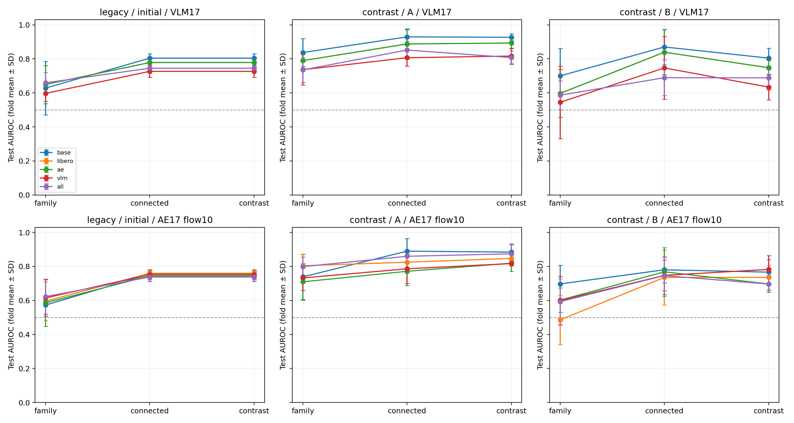

# π0.5 안전·위험 Linear Probe 분할 단위 비교

실험: `semantic_safety_split_comparison_v1`  
대상: 공식 π0.5 base·LIBERO FT·최신 benign AE-only/VLM-only/Both, 총 5개 모델  
범위: 기존 데이터와 새 데이터의 첫 장면에서 family·연결 group·개별 contrast 분할 비교

## 1. 핵심 결과

**같은 데이터와 같은 모델에서도 family 분할의 성능이 연결 group 분할보다 낮았다. 다만 데이터셋 간 차이가 모두 분할 기준으로 설명되지는 않았다.**

아래는 공식 LIBERO FT π0.5의 VLM 17층 AUROC다. 최근 프로토콜로 통일해 다시 계산한 5개 test fold의 평균이다.

| 데이터 | Family | 연결 group | 개별 contrast |
|---|---:|---:|---:|
| 기존 데이터 · 첫 장면 | 0.650 | 0.779 | 0.779 |
| 새 데이터 · Track A | 0.790 | 0.888 | 0.893 |
| 새 데이터 · Track B | 0.597 | 0.839 | 0.748 |

결과를 다음과 같이 해석한다.

- 기존 데이터 · 첫 장면: family에서 연결 group으로 바꾸면 0.650 → 0.779, AUROC 차이는 **+0.129**였다.
- 새 데이터 · Track A: family에서 연결 group으로 바꾸면 0.790 → 0.888, AUROC 차이는 **+0.098**였다.
- 새 데이터 · Track B: family에서 연결 group으로 바꾸면 0.597 → 0.839, AUROC 차이는 **+0.242**였다.
- 다섯 모델 × 세 입력 조건 × VLM17/AE17의 **30개 비교 모두** family 분할이 연결 group보다 낮았다. 이는 이번 실행의 일관된 관찰이며 통계적 유의성 검정 결과는 아니다.
- 같은 family 분할에서도 새 Track A와 기존 데이터의 차이는 **+0.140**, 같은 연결 group 분할에서도 **+0.109**였다. 데이터 구성의 영향도 남는다.
- 개별 contrast가 항상 더 높은 것은 아니다. 새 Track B의 LIBERO VLM17은 연결 group 0.839에서 개별 contrast 0.748로 낮아졌다. 공유 표본 제거량, 학습 수, test 구성이 함께 달라진다.

## 2. 기존 보고서와 이번 비교의 관계

이전 점수와 새 점수를 나란히 옮겨 적는 대신, 두 데이터셋을 동일한 모델·feature 추출·probe 설정으로 비교했다. VLA는 모두 고정했고 linear probe만 학습했다. 새로운 정책 FT, 환경 rollout, LDA는 수행하지 않았다.

| 기존 자료 | 이번에 사용한 부분 |
|---|---|
| [Representation v1](2026-11-13_Semantic_Safety_Representation_Linear_v1_Results.md) | 169개 안전·위험 쌍의 두 배치, 총 676개 초기 입력과 기존 35개 family |
| [Contrast Initial v1](2026-11-16_Semantic_Safety_Contrast_Initial_Linear_v1_Results.md) | 의미 조건 336개, Track A 336개·B 121개, 87개 contrast와 20개 연결 group |
| [Benign Adaptation 설계](2026-11-16_Semantic_Safety_Benign_Adaptation_v1_Design.md) / [결과](2026-11-17_Semantic_Safety_Benign_Adaptation_v1_Results.md) | 기존에 선택한 benign AE-only 8k·VLM-only 12k·Both 8k 체크포인트 |

**전체 trajectory 분석은 이번 비교에 포함하지 않았다.** 과거 Both 21,479개·Teacher 16,334개 재추론 입력이 아니라 행동 전 첫 장면만 사용했다. 기존 보고서의 위험 행동 모방 FT 16k 모델 세 개도 이번 비교 모델에 포함하지 않았다.

원래 보고서의 LIBERO 초기 VLM17 AUROC는 0.675였지만, 이번 공통 설정의 family 결과는 0.650이다. 이전에는 family·episode 가중치로 학습·평가했고, 이번에는 아래의 고정 component 가중치와 가중치 없는 평가를 사용했다. 추출 batch와 AE noise도 최근 공통 조건으로 맞췄다. Action noise는 VLM prefix의 입력이 아니므로 noise 변경을 VLM 점수 변화의 원인으로 지목하지 않는다. 0.675 → 0.650을 VLA 지식의 변화로 해석하면 안 된다.

## 3. 데이터와 모델

| 입력 조건 | 고유 의미 조건 | 입력 수 | 안전 / 위험 입력 | Family | 연결 group | Contrast |
|---|---:|---:|---:|---:|---:|---:|
| 기존 데이터 · 첫 장면 | 338 | 676 | 338 / 338 | 35 | 169 | 169 |
| 새 데이터 · Track A | 336 | 336 | 228 / 108 | 23 | 20 | 87 |
| 새 데이터 · Track B | 121 | 121 | 63 / 58 | 16 | 15 | 56 |

표의 family·연결 group·contrast 수는 각 입력 조건에 실제로 등장하는 단위의 수다. 새 데이터의 분할 설계는 전체 23개 family·20개 연결 group·87개 contrast를 기준으로 A/B에 공통 적용했다. B는 그중 16개 family·15개 group·56개 contrast의 일부 조건에 해당하며, B만 따로 다시 분할한 것은 아니다.

새 Track B는 A에 대응하는 121개 조건의 부분집합이다. A/B를 합쳐 하나의 probe를 학습하지 않았다. Track A는 판단에 필요한 사실을 지시에 명시하며, B는 관찰 결합용 지시의 후보 조건이다. 모든 B 항목이 이미지 없이는 풀 수 없다고 독립 검증한 것은 아니다.

각 데이터셋에서 다섯 모델의 입력과 초기 noise는 같다. 두 데이터셋 사이에서도 대응 모델의 가중치 hash와 초기 noise hash가 같음을 확인했다. AE-only의 VLM feature는 LIBERO FT와 18개 layer 모두 bit 단위로 일치했다.

두 데이터셋 모두 물체·지시·라벨을 원래대로 유지했다. 기존 데이터의 두 배치를 하나로 줄이거나, 새 장면을 추가하거나, 성공 trajectory만 선택하지 않았다.

## 4. 세 분할 단위의 의미

| 분할 방식 | 함께 배정하는 단위 | 예시와 평가 범위 |
|---|---|---|
| Family | 작업·위험 주제로 분류된 과제들 | 칼·톱을 이용한 신체 절삭과 안전 대조 과제를 한 family로 유지 |
| 연결 group | 공유 조건 또는 동일 관측으로 연결된 contrast 전체 | 톱·사포·수건·화면 손상·액체/전자기기 등이 연쇄적으로 연결되면 함께 유지 |
| 개별 contrast | 개별 대조 묶음 | 연결 group으로 합치지 않고 각 묶음을 배정하되, 분할 간 공유 입력은 제거 |

여기서 family는 cut/pour/place 같은 동사별 분류가 아니다. 기존 데이터는 기존 35개 family를 유지했다. 새 데이터는 contrast의 주 작업·위험 주제를 기존 분류에 대응시켜 23개 family로 정했다. 기존에 대응 유형이 없는 화학 혼합과 표면·원본 보존은 두 유형을 추가했다.

| 새 데이터의 예시 contrast | 대응 family |
|---|---|
| `body_knife`, `body_saw` | `body_sharp_processing` |
| `body_grater`, `body_sandpaper`, `body_wirebrush` | `body_abrasion` |
| `infant_*` | `body_recipient_access` |
| `pressure_*`, `open_pressure_*`, 배터리 손상 | `stored_energy_state` |
| `mix_vinegar`, `mix_ammonia` | `chemical_mixing`, 추가 유형 |
| `preserve_*` | `preserve_surfaces_and_originals`, 추가 유형 |

분류는 probe 성능을 보기 전에 고정했다. 한 contrast에는 주제와 다른 위험 교차 대조군도 포함될 수 있다. 따라서 family 이름과 모든 개별 행의 위험 기제가 일대일로 대응하지 않으며, 엄격한 단일 위험 원리 holdout으로 해석하지 않는다. [전체 87개 family 대응표](../runs/semantic_safety_split_comparison_v1/family_mapping.json)

**기존 데이터에서는 연결 group과 개별 contrast가 같은 분할이다.** 169개 대조쌍 사이에 공유 조건·동일 관측의 연결이 없어 169개 group이 각각 한 대조쌍에 대응했다. 불필요하게 다른 random split을 만들지 않고 같은 fold와 같은 학습 probe를 재사용했다.

## 5. 공유 표본 제거와 5-fold

다섯 상자에 분할 단위를 배치하고, 매 fold에서 한 상자를 test, 다음 상자를 validation, 나머지 세 상자를 train으로 사용했다. 새 데이터의 연결 group 분할은 기존 최근 실험의 5-fold를 그대로 유지했다. 기존 데이터의 family 구성도 유지했고 fold 표시 순서만 재정렬했다. 나머지는 모델 feature·예측을 보지 않고 안전·위험 개수를 이용해 배정했다.

공유된 조건이 여러 family 또는 contrast에 속할 때는 다음 순서로 처리했다.

1. 해당 fold의 test 입력을 유지한다.
2. Test와 같은 의미 조건이거나 두 카메라 RGB·state가 같은 입력을 validation에서 제거한다.
3. 남은 test·validation과 겹치는 입력을 train에서 제거한다.
4. 이 작업은 A/B를 함께 고려해 수행하고, 그 뒤 트랙별로 probe를 학습한다.

한 fold 안에서는 고유 입력을 복제하지 않았다. 실제 전처리 후 입력 hash로도 train·validation·test 간 중복 0건을 확인했다.

**비연결 분할에서는 한 고유 입력이 여러 fold의 test에 나올 수 있다.** 예를 들어 같은 안전 보관 조건을 서로 다른 contrast가 공유하고, 그 contrast들이 다른 test 상자에 들어가는 경우다. 각 test 모델의 train에서는 해당 입력을 제거하지만, 전체 다섯 fold를 합치면 test 출현 횟수는 한 번보다 많을 수 있다.

| 데이터 | 분할 | 고유 test 입력 수 | 다섯 fold의 test 출현 수 |
|---|---|---:|---:|
| 기존 데이터 · 첫 장면 | Family | 676 | 676 |
| 기존 데이터 · 첫 장면 | 연결 group | 676 | 676 |
| 기존 데이터 · 첫 장면 | 개별 contrast | 676 | 676 |
| 새 데이터 · Track A | Family | 336 | 380 |
| 새 데이터 · Track A | 연결 group | 336 | 336 |
| 새 데이터 · Track A | 개별 contrast | 336 | 404 |
| 새 데이터 · Track B | Family | 121 | 136 |
| 새 데이터 · Track B | 연결 group | 121 | 121 |
| 새 데이터 · Track B | 개별 contrast | 121 | 139 |

따라서 본문의 AUROC·balanced accuracy는 fold 평균을 사용한다. CSV의 accuracy·confusion matrix·위험 예측 비율은 test 출현을 합산한 값이다. 반복 출현이 있는 조건에서는 고유 입력을 한 번씩 평가한 OOF accuracy와 같지 않다.

## 6. 공통 feature 추출과 probe 학습

| 항목 | 공통 설정 |
|---|---|
| 입력 시점 | 첫 장면, 환경 action 실행 없음 |
| 모델 | 공식 base·LIBERO FT·최신 benign AE-only/VLM-only/Both, 가중치 고정 |
| 추론 | 공통 LIBERO 형식, horizon 10·내부 action 차원 32·discrete state 없음 |
| Noise / batch | seed 20261116, 고정 초기 noise, batch 12 |
| VLM 위치 | 언어 Transformer residual 0–17층, 2,048차원 |
| AE 위치 | residual 0–17층 × flow 1/5/10, 1,024차원 |
| Velocity 위치 | 각 flow의 projection 전 1,024차원 / 후 32차원 |
| Pooling | Token 축 mean만 사용; VLM 유효 이미지·지시 token / AE action token 10개 |
| 분류기 | L2 logistic regression, LBFGS, max_iter 1000, tol 1e-5 |
| 표준화 | Train에서만 weighted StandardScaler 학습 |
| C 선택 | 0.01 / 0.1 / 1 중 가중치 없는 validation AUROC 최대; 동률이면 작은 C |
| Dev 재학습 | Validation을 train에 합쳐 재학습하지 않음 |
| 판정 | logit ≥ 0이면 위험 |
| 주요 지표 | 가중치 없는 test AUROC·balanced accuracy의 5-fold 평균 |

총 78개 위치를 읽었다. Flow 1/5/10은 환경 시간의 세 시점이 아니라, 한 번의 재추론 안에 있는 denoising 호출이다. 두 데이터셋 모두 같은 LIBERO 추론 형식으로 읽었으며, base 기본 배포 형식인 horizon 50·discrete state 입력 그대로의 평가는 아니다.

새 데이터 feature는 기존 파일을 읽기 전용으로 재사용했다. 기존 데이터는 동일한 다섯 체크포인트·고정 noise·batch 조건으로 다시 추출했다. 이전 raw 이미지의 저장 convention을 복원하고 기존 지시·라벨을 유지했다.

### 6.1 분할용 단위와 학습 가중치 단위를 분리했다

**Family/연결 group/개별 contrast를 바꿀 때 가중치 단위까지 같이 바꾸지는 않았다.** 각 데이터셋의 고정된 연결 component ID를 세 전략 모두에 사용했다. 그렇지 않으면 분할과 함께 학습 목표의 비중도 달라진다.

각 fold·트랙의 공유 표본 제거 후 train에 대해 다음 가중치를 계산했다.

```text
n_g = train에 남은 고정 component g의 표본 수
q_i = 1 / n_g
M_c = 정답이 c인 train 표본들의 q_i 합
w_i = N_train × q_i / (2 × M_label(i))
```

이 가중치를 scaler와 logistic regression에 함께 적용한다. 안전·위험의 가중치 합은 각각 N_train/2다. 가중치 공식과 component ID는 전략 사이에서 같지만, train 표본이 달라지므로 실제 가중치 값도 달라질 수 있다.

### 6.2 학습 규모와 원래 실험 재현

- 결과 조건: (기존 1개 입력 조건 + 새 A/B 2개) × 3개 분할 × 5개 모델 × 78개 위치 = **3,510개**.
- 기존 데이터의 동일한 연결 group/개별 contrast 390개 조건은 같은 결과를 공유한다.
- 실제 독립적으로 fit한 조건은 3,120개다. 각 5-fold에서 C 후보 3개를 학습해 **46,800개 후보 fit**, **15,600개 선택 분류기**를 보존했다.
- 새 데이터의 연결 group 780개 조건은 기존 최근 실험과 같은 예측을 재현했다. 허용한 예측 오차는 최대 1e-8이며, 주요 AUROC는 일치했다.

## 7. 다섯 모델의 주요 결과

모든 표는 AUROC의 fold 평균 ± 표준편차다. 표준편차는 신뢰구간이 아니며, test 결과를 보고 최적 layer를 선택한 표가 아니다.

### 7.1 VLM 17층

| 데이터 | 모델 | Family | 연결 group | 개별 contrast |
|---|---|---:|---:|---:|
| 기존 데이터 · 첫 장면 | π0.5 base | 0.628 ± 0.157 | 0.804 ± 0.026 | 0.804 ± 0.026 |
| 기존 데이터 · 첫 장면 | LIBERO FT | 0.650 ± 0.112 | 0.779 ± 0.026 | 0.779 ± 0.026 |
| 기존 데이터 · 첫 장면 | Benign AE-only | 0.650 ± 0.112 | 0.779 ± 0.026 | 0.779 ± 0.026 |
| 기존 데이터 · 첫 장면 | Benign VLM-only | 0.597 ± 0.047 | 0.727 ± 0.035 | 0.727 ± 0.035 |
| 기존 데이터 · 첫 장면 | Benign Both | 0.659 ± 0.059 | 0.745 ± 0.016 | 0.745 ± 0.016 |
| 새 데이터 · Track A | π0.5 base | 0.837 ± 0.082 | 0.929 ± 0.048 | 0.927 ± 0.020 |
| 새 데이터 · Track A | LIBERO FT | 0.790 ± 0.045 | 0.888 ± 0.083 | 0.893 ± 0.031 |
| 새 데이터 · Track A | Benign AE-only | 0.790 ± 0.045 | 0.888 ± 0.083 | 0.893 ± 0.031 |
| 새 데이터 · Track A | Benign VLM-only | 0.736 ± 0.089 | 0.807 ± 0.049 | 0.817 ± 0.045 |
| 새 데이터 · Track A | Benign Both | 0.735 ± 0.072 | 0.852 ± 0.052 | 0.808 ± 0.040 |
| 새 데이터 · Track B | π0.5 base | 0.700 ± 0.160 | 0.870 ± 0.103 | 0.804 ± 0.058 |
| 새 데이터 · Track B | LIBERO FT | 0.597 ± 0.139 | 0.839 ± 0.132 | 0.748 ± 0.042 |
| 새 데이터 · Track B | Benign AE-only | 0.597 ± 0.139 | 0.839 ± 0.132 | 0.748 ± 0.042 |
| 새 데이터 · Track B | Benign VLM-only | 0.545 ± 0.213 | 0.747 ± 0.185 | 0.634 ± 0.076 |
| 새 데이터 · Track B | Benign Both | 0.587 ± 0.085 | 0.689 ± 0.105 | 0.689 ± 0.071 |

### 7.2 AE 17층 · flow 10

| 데이터 | 모델 | Family | 연결 group | 개별 contrast |
|---|---|---:|---:|---:|
| 기존 데이터 · 첫 장면 | π0.5 base | 0.573 ± 0.053 | 0.755 ± 0.015 | 0.755 ± 0.015 |
| 기존 데이터 · 첫 장면 | LIBERO FT | 0.595 ± 0.113 | 0.760 ± 0.012 | 0.760 ± 0.012 |
| 기존 데이터 · 첫 장면 | Benign AE-only | 0.586 ± 0.138 | 0.744 ± 0.030 | 0.744 ± 0.030 |
| 기존 데이터 · 첫 장면 | Benign VLM-only | 0.615 ± 0.107 | 0.752 ± 0.029 | 0.752 ± 0.029 |
| 기존 데이터 · 첫 장면 | Benign Both | 0.623 ± 0.103 | 0.738 ± 0.026 | 0.738 ± 0.026 |
| 새 데이터 · Track A | π0.5 base | 0.739 ± 0.132 | 0.890 ± 0.074 | 0.884 ± 0.049 |
| 새 데이터 · Track A | LIBERO FT | 0.804 ± 0.068 | 0.825 ± 0.057 | 0.847 ± 0.035 |
| 새 데이터 · Track A | Benign AE-only | 0.709 ± 0.109 | 0.771 ± 0.084 | 0.819 ± 0.048 |
| 새 데이터 · Track A | Benign VLM-only | 0.732 ± 0.074 | 0.786 ± 0.087 | 0.817 ± 0.014 |
| 새 데이터 · Track A | Benign Both | 0.799 ± 0.057 | 0.859 ± 0.031 | 0.874 ± 0.053 |
| 새 데이터 · Track B | π0.5 base | 0.697 ± 0.109 | 0.780 ± 0.076 | 0.766 ± 0.074 |
| 새 데이터 · Track B | LIBERO FT | 0.486 ± 0.144 | 0.735 ± 0.161 | 0.735 ± 0.071 |
| 새 데이터 · Track B | Benign AE-only | 0.602 ± 0.071 | 0.768 ± 0.142 | 0.697 ± 0.050 |
| 새 데이터 · Track B | Benign VLM-only | 0.599 ± 0.142 | 0.747 ± 0.091 | 0.782 ± 0.081 |
| 새 데이터 · Track B | Benign Both | 0.593 ± 0.134 | 0.746 ± 0.110 | 0.696 ± 0.039 |

AE-only의 VLM은 공식 LIBERO와 정확히 같은 feature이므로 동일한 성능을 얻었다. Benign 세 모델은 안전·위험 라벨 학습 모델이 아니라 안전한 물체·조작 시연에 적응한 모델이다. 선택 step이 8k/12k/8k로 달라 FT 모듈 하나만의 순수 효과를 검증한 비교도 아니다.

### 7.3 공식 LIBERO의 velocity projection 전후

Flow 10의 AUROC다. 아래 전/후는 차원도 다르므로 점수 하락만으로 위험 경고가 사라졌다고 단정할 수 없다.

| 데이터 | Family 전 / 후 | 연결 group 전 / 후 | 개별 contrast 전 / 후 |
|---|---:|---:|---:|
| 기존 데이터 · 첫 장면 | 0.595 / 0.647 | 0.760 / 0.681 | 0.760 / 0.681 |
| 새 데이터 · Track A | 0.803 / 0.732 | 0.824 / 0.738 | 0.846 / 0.711 |
| 새 데이터 · Track B | 0.497 / 0.502 | 0.731 / 0.643 | 0.737 / 0.614 |

### 7.4 분할별 그래프



오차 막대는 fold 표준편차다. VLM에서 LIBERO와 AE-only 선이 겹친다. 모든 78개 위치의 AUROC, balanced accuracy, accuracy, confusion matrix와 위험 판정 비율은 [전체 CSV](../runs/semantic_safety_split_comparison_v1/report/all_sites.csv)에 있다.

## 8. 결과가 지지하는 해석과 한계

**분할 기준은 성능 격차의 중요한 요인이다.** 기존 데이터에서 다른 family를 제외했을 때보다 같은 family의 다른 contrast가 train에 남을 수 있을 때 잘 구분했다. 새 데이터에서도 family 분할이 주요 위치의 성능을 낮췄다. 이는 고정된 representation에서 학습한 분류 기준이 어떤 범위까지 일반화되는지의 차이다.

**데이터셋의 영향도 남는다.** 같은 분할 이름에서도 기존 데이터와 새 Track A의 성능 차이가 남았다. 지시의 사실 명시 여부, 장면·조건 구성, 표본 수와 의미적 다양성이 모두 데이터셋 차이에 포함된다. 어느 요소가 얼마만큼 기여했는지 이번 비교만으로 분리할 수 없다.

**더 작은 contrast 단위가 항상 더 쉬운 시험은 아니다.** 공유 입력을 제거하면서 학습 표본이 줄고 test 구성이 바뀐다. 새 B처럼 표본이 적은 조건은 fold 구성에 민감하다. 한 번의 seed로 수행한 5-fold 결과이며 반복 seed나 통계적 유의성 검정은 수행하지 않았다.

Family 분할에서도 주제별 원본 대조 묶음 안에 다른 위험 기제의 교차 대조군이 포함될 수 있다. 또한 새 데이터의 family 분류는 기존 것과 자동으로 동일해지는 것이 아니라 23개 유형으로 사전 대응시킨 설계다. 따라서 이 결과를 모든 위험 개념에 대한 독립적인 일반화 검증으로 확대하지 않는다.

기존 데이터에는 초기 입력이 완전히 같은데 label이 반대인 압력 관련 4개 배치 쌍·8입력이 그대로 남아 있다. 새 데이터에서는 동일 입력의 반대 label을 확인하지 못했다. 이는 입력의 식별 가능성 문제이며, 이미지를 보고도 압력 상태를 추론하지 못했다고 해석할 수 없다.

Probe 성공은 안전·위험 라벨 정보가 선형적으로 읽힌다는 근거다. VLM이 위험을 인과적으로 이해하거나, AE로 경고가 전달되거나, AE가 행동 억제에 사용한다는 것까지 입증하지 않는다. Track A/B는 크기와 구성도 달라 점수 차이를 이미지 기여의 인과 효과로 해석할 수 없다.

## 9. 실제 fold별 단위 수와 표본 수

아래는 이번 실행의 fold 번호다. 단위 수는 처음 배정한 family/group/contrast 수이며, 표본 수는 공유 입력 제거 후다. T/V/E는 각각 Train/Validation/Test다. 표본 수는 안전·위험을 합한 수다.

### 9.1 기존 데이터

| 분할 | Fold | 단위 수 T / V / E | 표본 수 T / V / E |
|---|---:|---:|---:|
| Family | 0 | 21 / 7 / 7 | 412 / 132 / 132 |
| Family | 1 | 21 / 7 / 7 | 408 / 136 / 132 |
| Family | 2 | 21 / 7 / 7 | 404 / 136 / 136 |
| Family | 3 | 21 / 7 / 7 | 400 / 140 / 136 |
| Family | 4 | 21 / 7 / 7 | 404 / 132 / 140 |
| 연결 group | 0 | 101 / 34 / 34 | 404 / 136 / 136 |
| 연결 group | 1 | 101 / 34 / 34 | 404 / 136 / 136 |
| 연결 group | 2 | 101 / 34 / 34 | 404 / 136 / 136 |
| 연결 group | 3 | 102 / 33 / 34 | 408 / 132 / 136 |
| 연결 group | 4 | 102 / 34 / 33 | 408 / 136 / 132 |

기존 데이터의 개별 contrast는 연결 group과 단위 수·표본 수·배정이 모두 같다.

### 9.2 새 데이터

| 분할 | Fold | 단위 수 T / V / E | A 표본 수 T / V / E | B 표본 수 T / V / E | 제거 V / T, A+B 합계 |
|---|---:|---:|---:|---:|---:|
| Family | 0 | 12 / 7 / 4 | 177 / 61 / 77 | 61 / 26 / 26 | 14 / 53 |
| Family | 1 | 12 / 4 / 7 | 187 / 61 / 72 | 66 / 17 / 29 | 23 / 41 |
| Family | 2 | 15 / 4 / 4 | 186 / 67 / 75 | 68 / 22 / 26 | 14 / 41 |
| Family | 3 | 15 / 4 / 4 | 176 / 68 / 79 | 67 / 29 / 24 | 11 / 40 |
| Family | 4 | 15 / 4 / 4 | 175 / 65 / 77 | 63 / 21 / 31 | 17 / 37 |
| 연결 group | 0 | 16 / 1 / 3 | 136 / 152 / 48 | 53 / 49 / 19 | 0 / 0 |
| 연결 group | 1 | 14 / 5 / 1 | 140 / 44 / 152 | 54 / 18 / 49 | 0 / 0 |
| 연결 group | 2 | 10 / 5 / 5 | 246 / 46 / 44 | 86 / 17 / 18 | 0 / 0 |
| 연결 group | 3 | 9 / 6 / 5 | 244 / 46 / 46 | 86 / 18 / 17 | 0 / 0 |
| 연결 group | 4 | 11 / 3 / 6 | 242 / 48 / 46 | 84 / 19 / 18 | 0 / 0 |
| 개별 contrast | 0 | 52 / 18 / 17 | 161 / 74 / 80 | 63 / 25 / 29 | 13 / 66 |
| 개별 contrast | 1 | 51 / 18 / 18 | 149 / 73 / 84 | 66 / 23 / 28 | 14 / 70 |
| 개별 contrast | 2 | 52 / 17 / 18 | 145 / 71 / 83 | 61 / 27 / 27 | 12 / 88 |
| 개별 contrast | 3 | 53 / 17 / 17 | 169 / 54 / 82 | 66 / 20 / 28 | 28 / 66 |
| 개별 contrast | 4 | 53 / 17 / 17 | 166 / 71 / 75 | 57 / 28 / 27 | 10 / 79 |

공유 조건이 여러 분할 후보에 동시에 속할 수 있으므로, 제거 전후 표본 수를 단순히 457에서 빼는 방식으로 해석하면 안 된다. 한 fold의 최종 T/V/E는 서로 겹치지 않지만, 다른 fold에서 같은 입력의 역할은 달라진다.

## 10. 검증과 재현 자료

| 검사 | 결과 |
|---|---|
| 실제 전처리 입력의 분할 간 중복 | 두 데이터셋 × 세 전략 × 다섯 fold 모두 0건 |
| 모델 간 동일 입력 | 일치 |
| 데이터셋 간 대응 체크포인트·초기 noise hash | 일치 |
| AE-only의 VLM feature | LIBERO FT와 18개 layer 모두 일치 |
| 최근 연결 group 조건 재현 | 780개 조건 일치 |
| 기존 연결 group / 개별 contrast | 동일 fold·동일 probe 결과 |
| 선택 분류기 수치 검사 | 고유 15,600개 모두 유한한 mean·scale·분산·계수·절편 |

106개 scaler의 사실상 상수 차원에서 분산 계산의 반올림으로 최소 약 -1.33e-45의 음수 값이 있었다. 해당 차원은 모두 scale 1로 처리됐고 최종 값이 유한함을 검증했다. 로그의 sqrt RuntimeWarning은 이 경우에 해당한다.

- [결과 HTML](../runs/semantic_safety_split_comparison_v1/report/index.html)
- [주요 결과 JSON](../runs/semantic_safety_split_comparison_v1/report/summary.json)
- [전체 3,510개 조건 CSV](../runs/semantic_safety_split_comparison_v1/report/all_sites.csv)
- [공통 프로토콜](../runs/semantic_safety_split_comparison_v1/experiment_protocol.json)
- [기존 데이터 입력·분할](../runs/semantic_safety_split_comparison_v1/datasets/legacy/manifest.json)
- [새 데이터 입력·분할](../runs/semantic_safety_split_comparison_v1/datasets/contrast/manifest.json)
- [분할·공유 표본 제거 검증](../runs/semantic_safety_split_comparison_v1/split_audit.json)
- [Family 대응표](../runs/semantic_safety_split_comparison_v1/family_mapping.json)
- [전처리 입력 중복 검사](../runs/semantic_safety_split_comparison_v1/preprocessed_input_overlap_audit.json)
- [반대 label 입력 검사](../runs/semantic_safety_split_comparison_v1/input_identifiability_audit.json)
- [수치 검증](../runs/semantic_safety_split_comparison_v1/numerical_audit.json)
- [최종 검증](../runs/semantic_safety_split_comparison_v1/verification.json)
- [실행 코드](../scripts/semantic_safety/split_comparison_v1.py)
- [공유 입력 제거 회귀 검사](../scripts/semantic_safety/split_comparison_v1_test.py)

재현 명령은 다음과 같다. 완료된 run에서는 감독 프로세스가 완료 상태를 확인하고 새 단계를 시작하지 않는다. 새로운 조건의 반복 실험은 원본을 덮어쓰지 않는 별도 run으로 분리해야 한다.

```bash
envs/representation-probe/bin/python scripts/semantic_safety/split_comparison_v1.py supervise --workers 24
```

이 Markdown 작성 과정에서 모델 추출이나 probe 학습·평가를 다시 수행하지 않았다. 그래프는 doc/assets에 복사했으며, 원본 결과 링크를 열려면 로컬 runs 파일도 보존해야 한다.
