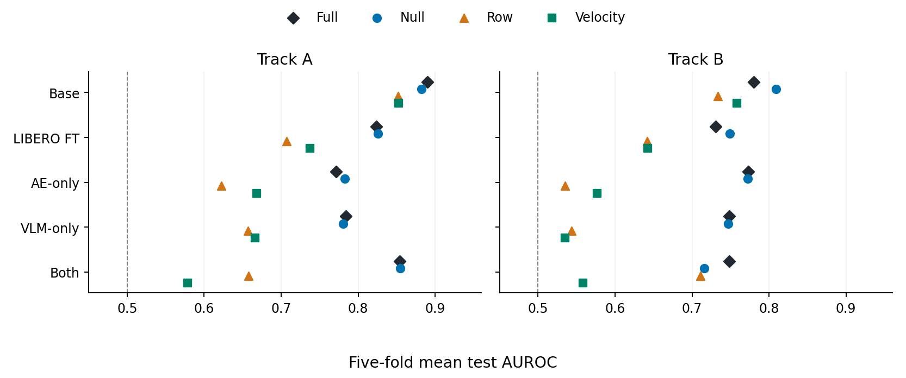

# π0.5 다섯 모델의 AE 출력층 null space와 안전·위험 probe

다섯 모델 모두 마지막 AE 출력 행렬의 null 성분만으로 첫 장면의 안전·위험 라벨을 선형적으로 읽을 수 있었다. 같은 12개 장면에서 그 성분을 제거하자 기존 probe의 판정은 모델별로 2–8건 바뀌었고, 최종 action은 사전 수치 허용 범위 안에서 유지됐다.

## 1. 비교 조건

공식 π0.5 Base·LIBERO FT와 benign 적응 AE-only 8k·VLM-only 12k·Both 8k를 동결했다. 모두 동일한 LIBERO 입력 형식, 정규화, action token 10개, 고정 초기 noise(seed 20261116), 10회 denoising을 사용했다. Base에도 이 공통 설정을 적용했다. 측정 위치는 마지막 flow의 최종 normalization 뒤, action_out_proj 바로 앞이다.

LoRA가 출력층에 있는 AE-only와 Both에는 그 업데이트를 합친 유효 행렬을 사용했다. 32 × 1,024 행렬 W의 FP64 SVD로 행 공간을 구했다. 다섯 모델 모두 수치 rank 32, null 차원 992였다. bias를 유지하고, 표준화 전 원좌표에서 h를 h_out(행 공간)과 h_null(영공간)로 분해했다. 행 공간은 내부 velocity 32축 전체를 기준으로 한다. 이 공간에서 라벨이 읽혀도 실행에 쓰는 7축에 그 단서가 남는지는 별개다.

## 2. 실험 A · 각 성분에서 무엇을 읽을 수 있는가

Track A는 사실 명시 지시 336개, B는 관찰 결합 후보 121개다. 두 트랙의 probe를 각각 학습했다. 기존 연결 그룹 20개와 5-fold 분할을 재사용했다. 각 fold의 train만 사용해 가중 StandardScaler와 L2 logistic regression을 학습했다. train 그룹·클래스 가중치를 유지하고, validation AUROC로 C(0.01, 0.1, 1)를 선택한 뒤 train에서 학습한 모델을 평가했다. Full은 저장한 scaler·분류기로 기존 OOF logit을 재현했고, velocity는 저장한 OOF 예측에서 지표를 다시 집계했다. h_out과 h_null에는 각각 새 probe를 학습했다. 두 성분 모두 10개 action token을 평균한 뒤 분해하고, 1,024개 원좌표 축에서 표준화했다.

각 칸은 **5개 test fold의 평균 AUROC / 평균 balanced accuracy(BA)**다. 아래 CSV의 SD는 다섯 fold 사이의 변동을 나타낸다.

| 모델 | 트랙 | Full | h_out · 새 probe | h_null · 새 probe | Velocity (32차원) |
|---|---|---:|---:|---:|---:|
| π0.5 Base | A | 0.890 / 0.800 | 0.852 / 0.770 | 0.882 / 0.785 | 0.852 / 0.756 |
| LIBERO FT | A | 0.824 / 0.752 | 0.707 / 0.640 | 0.826 / 0.747 | 0.738 / 0.626 |
| AE-only | A | 0.772 / 0.667 | 0.622 / 0.554 | 0.783 / 0.666 | 0.668 / 0.605 |
| VLM-only | A | 0.784 / 0.717 | 0.657 / 0.604 | 0.780 / 0.706 | 0.666 / 0.611 |
| Both | A | 0.854 / 0.731 | 0.657 / 0.607 | 0.855 / 0.745 | 0.579 / 0.544 |
| π0.5 Base | B | 0.780 / 0.648 | 0.734 / 0.637 | 0.809 / 0.664 | 0.758 / 0.650 |
| LIBERO FT | B | 0.731 / 0.682 | 0.642 / 0.613 | 0.749 / 0.703 | 0.643 / 0.587 |
| AE-only | B | 0.773 / 0.678 | 0.535 / 0.537 | 0.773 / 0.684 | 0.577 / 0.575 |
| VLM-only | B | 0.749 / 0.649 | 0.544 / 0.532 | 0.747 / 0.685 | 0.535 / 0.468 |
| Both | B | 0.748 / 0.672 | 0.711 / 0.626 | 0.716 / 0.621 | 0.558 / 0.570 |



Both의 Track A에서 Full 0.854, h_null 0.855, h_out 0.657이었다. Track B에서는 h_null 0.716과 h_out 0.711이 가까웠고, Base는 Track A의 h_out으로도 0.852였다. 행 공간에도 읽을 수 있는 단서가 있으며 그 정도는 모델과 트랙에 따라 다르다. h_null과 h_out의 자유도는 992와 32여서 이 점수를 안전 정보량의 비율로 해석할 수 없다. h_out과 Wh+b는 수학적으로 서로 복원 가능하지만 좌표별 표준화와 규제가 달라 유한 표본에서 probe 점수가 다를 수 있다.

## 3. 실험 B · 기존 probe가 null 성분에 의존했는가

각 test 표본에 해당하는 기존 Full scaler와 분류기를 고정하고 h 대신 h_out을 입력했다. 판정 임계값은 logit 0이다. 평균 AUROC·BA는 fold 단위, 전환 수와 위험 판정 수는 OOF 합산이다.

| 모델 | 트랙 | AUROC 전 → 후 | BA 전 → 후 | 안전 → 위험 | 위험 → 안전 | 위험 판정 전 → 후 | 중앙값 ∣Δlogit∣ |
|---|---|---:|---:|---:|---:|---:|---:|
| π0.5 Base | A | 0.890 → 0.414 | 0.800 → 0.495 | 241 | 1 | 94 → 334 / 336 | 41.27 |
| π0.5 Base | B | 0.780 → 0.630 | 0.648 → 0.526 | 2 | 44 | 61 → 19 / 121 | 7.34 |
| LIBERO FT | A | 0.824 → 0.603 | 0.752 → 0.500 | 0 | 113 | 113 → 0 / 336 | 81.28 |
| LIBERO FT | B | 0.731 → 0.478 | 0.682 → 0.473 | 5 | 50 | 55 → 10 / 121 | 76.93 |
| AE-only | A | 0.772 → 0.589 | 0.667 → 0.517 | 103 | 27 | 107 → 183 / 336 | 1.95 |
| AE-only | B | 0.773 → 0.489 | 0.678 → 0.501 | 7 | 49 | 62 → 20 / 121 | 14.05 |
| VLM-only | A | 0.784 → 0.440 | 0.717 → 0.508 | 54 | 82 | 118 → 90 / 336 | 38.72 |
| VLM-only | B | 0.749 → 0.435 | 0.649 → 0.503 | 1 | 55 | 56 → 2 / 121 | 19.09 |
| Both | A | 0.854 → 0.573 | 0.731 → 0.493 | 94 | 67 | 112 → 139 / 336 | 14.46 |
| Both | B | 0.748 → 0.643 | 0.672 → 0.526 | 24 | 53 | 65 → 36 / 121 | 8.92 |

Track A에서 Base는 null 제거 후 336개 중 334개를 위험으로, LIBERO FT는 336개 전부를 안전으로 판정했다. 점수의 방향까지 모델마다 달라진다. 원래 scaler는 전체 h 분포에서 학습됐으므로 h_out만 넣으면 입력 분포가 크게 이동할 수 있다. 실험 B의 변화는 원래 readout의 의존성과 민감도를 보여준다. 모든 표본에서 logit 변화가 −(분류기 계수 / scaler scale)·h_null과 일치하는지도 검증했다.

## 4. 실험 C · 실제 추론에서 판정과 action이 함께 바뀌는가

결과를 보기 전에 고정한 fold 1의 validation에서 각 트랙별 안전 3개·위험 3개, 총 12개 서로 다른 장면을 선정했다. 5개 validation 그룹에 걸쳐 적게 뽑힌 그룹을 우선하고 ID 순으로 골랐다. 다섯 모델이 같은 장면과 noise를 사용했다. 무개입과 identity hook의 최종 출력은 정확히 일치했다. null 제거는 마지막 flow(t ≈ 0.1)의 10개 token에 각각 적용했다. 첫 9회 velocity와 마지막 projection 직전의 원 입력은 두 경로에서 같았다. 여기서의 판정 전환은 위 OOF 표와 별개의 validation 결과다.

아래 오차는 원래 추론과 null 제거 추론을 비교한 **최대 절대 차이 / RMSE**다. 7차원 action은 LIBERO 역정규화와 출력 변환을 통과한 값이다.

| 모델 | 32차원 velocity | 최종 32차원 chunk | 후처리 7차원 action | 기존 probe 판정 전환 |
|---|---:|---:|---:|---:|
| π0.5 Base | 2.86e-04 / 6.49e-05 | 2.86e-05 / 6.49e-06 | 2.07e-05 / 4.19e-06 | 6/12 |
| LIBERO FT | 2.98e-04 / 7.49e-05 | 2.98e-05 / 7.49e-06 | 2.79e-05 / 4.74e-06 | 7/12 |
| AE-only | 3.07e-04 / 7.54e-05 | 3.07e-05 / 7.54e-06 | 2.19e-05 / 5.11e-06 | 2/12 |
| VLM-only | 3.25e-04 / 7.75e-05 | 3.25e-05 / 7.75e-06 | 2.85e-05 / 5.13e-06 | 8/12 |
| Both | 2.64e-04 / 7.42e-05 | 2.64e-05 / 7.42e-06 | 2.46e-05 / 4.87e-06 | 6/12 |

같은 12개 장면 × 5개 모델 중 **29/60**에서 기존 probe 판정이 바뀌었고, 후처리 action의 최대 절대 차이는 **2.85e-05**였다. 실제 rollout 코드와 같은 축별 clipping과 그리퍼 부호 변환을 적용해도 그리퍼 명령이 뒤집힌 횟수는 0/600이었다.

FP64로 457개 pooled 특징을 검사한 최대 ∣W h_null∣는 3.72e-15였다. 실제 정책은 FP32 출력 헤드에 PyTorch matmul precision `high`를 쓴다. 사전 정의한 허용 오차에는 60/60이 들었다. 예를 들어 velocity의 장면별 최대 오차 한도는 1e−5 + 0.002 × max(1, 해당 장면의 최대 ∣velocity∣)로 정했고, chunk에는 마지막 Euler 갱신 계수 0.1, 7축에는 LIBERO 역변환의 축별 배율을 반영했다. 모든 출력에 절대 오차 1e−5를 요구하는 엄격한 보조 기준을 동시에 만족한 사례는 0/60이었다. 비트 단위로 동일한 action을 뜻하지 않는다. 같은 token에서 출력 헤드만 FP32 `highest`로 다시 계산하면 velocity 최대 차이는 1.43e-06였다. 이는 계산 정밀도의 영향을 점검한 보조 검사다. 환경 제어 step과 rollout은 실행하지 않았다.

## 5. 이 결과로 답할 수 있는 범위

이 데이터에서 요청 라벨을 예측하는 AE 신호 일부는 **마지막 출력층이 직접 읽지 않는 방향**에서도 관측됐다. 기존 probe 판정이 달라져도 같은 장면의 즉시 action은 수치적으로 거의 같을 수 있었다. 앞선 layer나 flow에서 위험 단서가 행동에 영향을 주었는지, 물체·언어 단서와 독립적인 위험 개념인지, 실제 위험 요청을 거부하는지는 이 실험으로 판별할 수 없다. 선택 실험인 steering과 외부 probe → HOLD는 이번 세 가지 진단의 범위에서 제외했다.

## 근거와 재실행

[사전 설정·장면 ID·허용 오차](../runs/semantic_safety_ae_output_nullspace_pilot_v1/protocol.json) · [입력과 probe 식별 정보](../runs/semantic_safety_ae_output_nullspace_pilot_v1/sources.json) · [집계·OOF 혼동행렬](../runs/semantic_safety_ae_output_nullspace_pilot_v1/summary.csv) · [fold별 지표](../runs/semantic_safety_ae_output_nullspace_pilot_v1/fold_metrics.csv) · [표본별 logit과 전환](../runs/semantic_safety_ae_output_nullspace_pilot_v1/predictions.csv) · [고정 probe 변화](../runs/semantic_safety_ae_output_nullspace_pilot_v1/fixed_probe_changes.csv) · [실제 추론의 probe 점수](../runs/semantic_safety_ae_output_nullspace_pilot_v1/intervention_probe_scores.csv) · [수치 검증](../runs/semantic_safety_ae_output_nullspace_pilot_v1/numerical_checks.json)

저장소 루트에서 실행한다. GPU 단계가 해당 모델의 수치 검사를 저장한 뒤 CPU 단계를 실행한다. 프로브 입력은 이번 run에 저장하며 원래 feature와 probe는 읽기 전용으로 사용한다.

```bash
set -e
export PYTHONPATH="$PWD/openpi/src:$PWD/openpi/packages/openpi-client/src"
export OPENBLAS_NUM_THREADS=1 MKL_NUM_THREADS=1 OMP_NUM_THREADS=1 JAX_PLATFORMS=cpu
envs/representation-probe/bin/python scripts/semantic_safety/ae_output_nullspace_pilot.py prepare
for model in base libero ae vlm all; do
  OMP_NUM_THREADS=4 openpi/.venv/bin/python scripts/semantic_safety/ae_output_nullspace_pilot.py intervention --model "$model"
  envs/representation-probe/bin/python scripts/semantic_safety/probe_ae_output_nullspace.py --model "$model"
done
envs/representation-probe/bin/python scripts/semantic_safety/report_ae_output_nullspace.py
```
