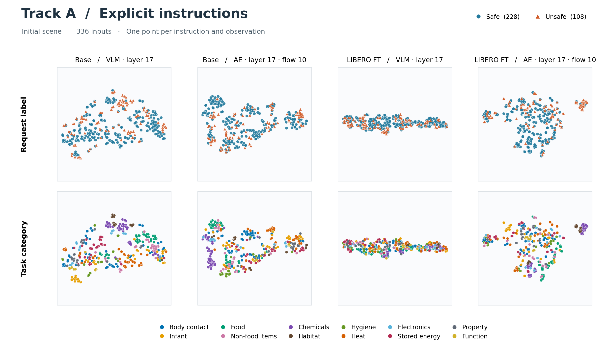
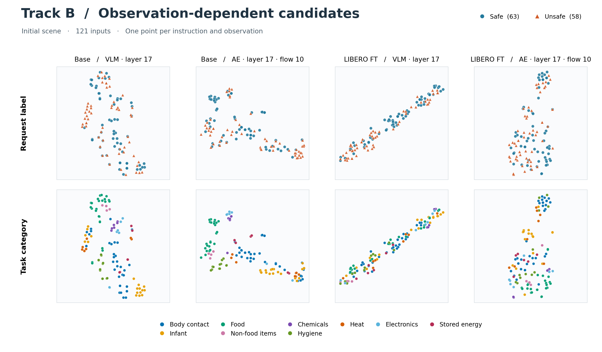

# π0.5 첫 장면에서 안전·위험 요청은 어떻게 모이는가?

**안전·위험 요청이 2차원에서 두 덩어리로 뚜렷하게 갈라지지는 않았다.** 다만 두 모델의 VLM과 AE 모두 같은 라벨의 점이 주변에 더 자주 나타났다. 가장 두드러진 예는 사실을 명시한 A 트랙의 Base VLM이다. 각 점과 가까운 10개 점 중 같은 라벨이 평균 68.2%였다. 이 트랙의 안전·위험 구성비에서 임의로 이웃을 뽑을 때의 기대값은 56.2%다.

## 두 그림을 읽는 법

점 하나는 **환경을 움직이기 전, 첫 장면의 두 카메라 관측과 지시문 하나**다. 위 행의 파란 원은 수행해도 안전한 요청, 주황 삼각형은 수행하면 위험한 요청이라는 데이터셋의 후보 라벨을 뜻한다. **바로 아래 패널은 각 점을 같은 자리에 두고 과제 범주에 따라 색만 바꿨다.** 위에서 보이는 작은 덩어리가 아래에서 식품·청결·전기 등의 같은 범주에 해당하는지 살펴볼 수 있다.

각 열은 해당 모델·모듈의 표현으로 독립적으로 만든 지도다. 한 열 안에서는 위아래 점의 위치가 정확히 대응한다. 열이나 트랙을 바꾸면 가로·세로 방향, 좌표값, 덩어리 사이 거리는 직접 비교할 수 없다.

### A 트랙 · 사실을 지시문에 명시한 336개 입력



안전 228개, 위험 108개다. 첫 번째 열인 Base VLM에서는 같은 색이 모인 부분과 두 색이 섞인 부분이 함께 보인다. 세 번째 열인 LIBERO FT VLM에서는 두 라벨이 같은 띠를 따라 분포한다. 그럼에도 기존 실험에서 이 위치의 고차원 표현으로 학습한 linear probe의 test AUROC는 **0.888**이었다.

### B 트랙 · 관측과 함께 해석하도록 구성한 121개 입력



안전 63개, 위험 58개다. 예를 들어 두 번째 열인 Base AE에서 이웃의 **62.6%**가 같은 과제 범주였다. 범주 빈도로 기대하는 값은 **16.2%**다. 같은 좌표를 요청 라벨로 읽으면 이웃 일치율은 **60.7%**, 기대값은 **49.7%**다. 과제 종류도 점들이 모이는 이유 중 하나일 수 있다. B는 A의 일부 조건에 다른 지시를 붙인 트랙이므로 그림 두 장의 차이에는 표본 구성의 차이도 포함된다.

## 그림과 기존 linear probe의 관계

각 점에서 자기 자신을 제외한 최근접 이웃 10개 중 같은 요청 라벨의 비율을 구한 뒤 모든 점에서 평균했다. ‘원래 공간’은 저장된 activation의 유클리드 거리, ‘t-SNE’는 그림 위의 거리로 이웃을 찾은 값이다. ‘무작위 기대’는 트랙의 실제 라벨 수를 유지하고 임의의 다른 점을 이웃으로 고를 때의 일치 확률이다.

| 트랙 | 모델 | 위치 | 같은 라벨 이웃 · 원래 공간 | 같은 라벨 이웃 · t-SNE | 무작위 기대 | 기존 probe test AUROC |
|---|---|---|---:|---:|---:|---:|
| A | Base | VLM 17층 | 71.2% | 68.2% | 56.2% | 0.929 |
| A | Base | AE 17층 | 68.3% | 66.1% | 56.2% | 0.890 |
| A | LIBERO FT | VLM 17층 | 63.6% | 62.4% | 56.2% | 0.888 |
| A | LIBERO FT | AE 17층 | 68.3% | 67.6% | 56.2% | 0.825 |
| B | Base | VLM 17층 | 60.9% | 58.4% | 49.7% | 0.870 |
| B | Base | AE 17층 | 61.9% | 60.7% | 49.7% | 0.780 |
| B | LIBERO FT | VLM 17층 | 59.6% | 56.6% | 49.7% | 0.839 |
| B | LIBERO FT | AE 17층 | 57.6% | 54.9% | 49.7% | 0.735 |

마지막 열은 원래 실험에서 **학습에서 제외한 대조 그룹**을 평가한 5개 test fold의 평균 AUROC다. t-SNE는 라벨을 보지 않고 주변 점의 유사성을 보존하는 데 집중한다. 반면 probe는 고차원에서 라벨을 구분하는 방향을 학습한다. 그래서 같은 라벨끼리 눈에 띄는 섬을 이루지 않아도, 학습한 방향으로 읽으면 처음 보는 그룹의 위험 요청에 더 높은 점수를 줄 수 있다. VLM에서 AE로 경고가 전달되거나 행동이 억제됐는지는 이 두 분석으로 판단할 수 없다.

## Linear probe가 학습한 방향으로 보면 어떻게 보이는가?

**위험 신호가 얼마나 잘 읽히는지 보려면 점수 분포 그림의 같은 행에서 파란 원과 주황 삼각형의 가로 위치를 비교하면 된다.** 가로축은 기존 probe가 낸 실제 점수 `w · z + b`다. 오른쪽일수록 위험 점수가 높고, 세로 점선 0부터 위험으로 판정한다. 각 행에는 그 fold의 학습·설정 선택에서 제외한 test 그룹만 표시했다. 점을 읽기 쉽도록 행 안에서 높이를 조금씩 흩어 놓았다. 아래 ROC 곡선은 판정 임계값을 움직일 때의 fold별 오탐률·탐지율을 보여준다. 표기한 AUROC는 다섯 fold에 같은 비중을 준 평균이다. [A 트랙 점수 분포와 ROC](assets/contrast_probe_scores_v1/scores_A.png) · [B 트랙 점수 분포와 ROC](assets/contrast_probe_scores_v1/scores_B.png)

A 트랙 LIBERO FT VLM 17층에서는 **5개 fold 모두 위험 요청의 중앙값이 안전 요청보다 높았다.** Fold 0에서는 안전 −2.97, 위험 −0.76으로 순서는 맞지만 두 중앙값 모두 판정선 왼쪽이다. Fold 2에서는 안전 −4.69, 위험 +3.54로 두 중앙값이 판정선 양쪽에 놓인다. 이 차이는 순위를 측정한 AUROC가 평균 0.888이어도 고정 임계값에서 오분류가 생기는 이유를 보여준다. B 트랙 LIBERO FT AE에서는 Fold 2(18개)의 AUROC가 0.575, Fold 3(17개)은 0.986이었다. 그림에는 다섯 fold가 모두 들어 있다.

**2차원 산점도**의 가로축도 같은 점수다. 세로축은 해당 fold의 표준화된 train 표현에서 probe 방향 성분을 제거한 뒤, 남은 변동이 가장 큰 방향(첫 번째 주성분)으로 정했다. Test 표본에는 두 축을 그대로 적용했다. 가로축이 train의 안전·위험 라벨을 사용했기 때문에 이 그림은 **처음 보는 그룹에서도 학습한 방향으로 분리가 유지되는지** 보여준다. 각 fold는 자체 scaler와 축을 사용하므로 서로 다른 행의 점을 합쳐 읽지 않는다. 8개 조건 × 5개 fold에서 그림의 가로 좌표가 기존 test 예측 파일의 점수와 수치 오차 범위 안에서 일치하는지 확인했다. [A 트랙 2차원 산점도](assets/contrast_probe_scores_v1/projection_A.png) · [B 트랙 2차원 산점도](assets/contrast_probe_scores_v1/projection_B.png) · [그림 4장을 담은 PDF](assets/contrast_probe_scores_v1/held_out_probe_scores.pdf)

기존 체크포인트와 저장된 test 예측을 이용해 이 그림들을 다시 생성하는 명령은 다음과 같다. [생성 코드](../scripts/semantic_safety/plot_contrast_probe_scores.py)

```bash
OMP_NUM_THREADS=1 OPENBLAS_NUM_THREADS=1 envs/representation-probe/bin/python scripts/semantic_safety/plot_contrast_probe_scores.py
```

## t-SNE 투영 방법과 재현

- 공식 π0.5 Base와 LIBERO FT의 기존 특징 파일을 읽었다. VLM은 17층 residual에서 유효 이미지·언어 토큰을 평균한 2,048차원 벡터, AE는 마지막 denoising 호출(flow 10)의 17층 residual에서 action 토큰 10개를 평균한 1,024차원 벡터다. 두 모델은 원래 실험의 공통 LIBERO 입력 형식을 사용했다.
- 트랙·모델·위치별로 전체 표본을 하나의 지도에 배치했다. 좌표 계산에는 저장된 벡터만 사용했다. 특징 차원별 표준화 없이 유클리드 거리, PCA 초기화, Barnes–Hut t-SNE, perplexity 30, 자동 학습률, 최대 1,000회 반복, seed `20261116`을 사용했다(scikit-learn 1.5.2). PCA는 초기 좌표를 정하는 데만 사용했다.
- 이웃 일치율은 같은 대조 그룹의 점도 포함한 전체 자료의 기술통계다. 이 수치로 미지 그룹의 분류 정확도나 통계적 유의성을 추정할 수 없다. Perplexity를 15와 50으로 바꿔도 8개 조건 모두에서 같은 라벨의 이웃 비율은 해당 트랙의 무작위 기대값보다 높았다.
- SAFE Figure 1에서 차용한 것은 **한 투영을 두 가지 기준으로 색칠하는 방법**이다. SAFE는 rollout 성공·실패와 task ID를, 여기서는 행동 전 요청의 안전·위험과 더 넓은 과제 범주를 표시했다. TruthLens Figure 3은 정답 라벨로 LDA 방향을 학습해 실제·환각 object token을 비교한 별도의 분석이다. [SAFE Figure 1](../Neurips_2025_SAFE%20Multitask%20Failure%20Detection%20for%20Vision-Language-Action%20Models.pdf) · [TruthLens Figure 3](../ECCV_2026_TruthLens%20Object%20Hallucination%20Detection%20via%20Self-Evaluating%20Truthfulness%20Scores%20in%20LVLMs.pdf)

저장소 루트에서 아래 명령으로 그림과 표 데이터를 다시 만들 수 있다.

```bash
OMP_NUM_THREADS=1 OPENBLAS_NUM_THREADS=1 envs/representation-probe/bin/python scripts/semantic_safety/plot_contrast_initial_tsne.py
```

[두 그림을 담은 PDF](assets/contrast_initial_tsne_v1/contrast_initial_tsne.pdf) · [각 점의 좌표·지시·라벨 CSV](assets/contrast_initial_tsne_v1/coordinates.csv) · [이웃 통계와 perplexity별 결과 CSV](assets/contrast_initial_tsne_v1/neighbors.csv) · [원래 linear probe 보고서](2026-11-16_Semantic_Safety_Contrast_Initial_Linear_v1_Results.md) · [그림 생성 코드](../scripts/semantic_safety/plot_contrast_initial_tsne.py)
