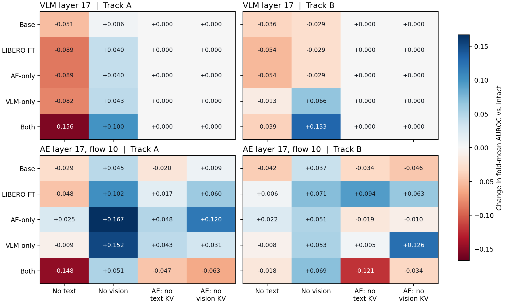

# π0.5에서 지시·영상·로봇 상태를 가렸을 때의 안전 probe와 LIBERO 과제 성공률

다섯 모델의 VLM 마지막 층에서 새로 학습한 probe의 AUROC 중앙값은 트랙 A에서 전체 입력 0.888, 지시 차단 0.799, 영상 차단 0.928였다. 트랙 B에서는 각각 0.839, 0.786, 0.812였다. 공식 LIBERO FT 정책의 실제 과제 성공은 같은 12개 초기 배치에서 전체 입력 12/12, 지시 차단 8/12, 영상 차단 0/12였다.

## 1. 무엇을 비교했는가

가중치를 고정한 공식 Base·LIBERO FT, benign 과제에 적응한 AE-only 8k·VLM-only 12k·Both 8k를 사용했다. 주 분석에서는 다섯 모델에 동일한 LIBERO 전처리·정규화와 10개 action token, 10회 denoising을 적용했다. Base의 상태 입력과 horizon 50은 5절에서 별도로 평가했다.

| 조건 | VLM에서 읽을 수 있는 입력 | AE가 읽을 수 있는 VLM KV |
|---|---|---|
| 전체 입력 | 외부·손목 영상과 지시 전체 | 모든 유효 위치 |
| 지시 차단 | 두 카메라 영상 | 영상 위치 |
| 영상 차단 | 지시 | 지시 위치 |
| AE 지시 KV 차단 | 영상과 지시 전체 | 영상 위치 |
| AE 영상 KV 차단 | 영상과 지시 전체 | 지시 위치 |

전체 입력 단계의 차단은 지정한 prefix 위치를 attention의 유효 토큰에서 제외하고 위치 번호를 다시 계산한다. 지시 차단에는 BOS와 줄바꿈도 포함했다. 영상 차단은 외부 카메라 256개와 손목 카메라 256개 위치에 적용했다. AE 전용 차단은 VLM이 원래 KV를 만든 뒤 열 방향으로 적용하며, 10번의 denoising 모두에서 위치 번호와 action token 사이의 attention을 보존했다. 이때 영상 위치의 KV에도 지시 정보가, 지시 위치의 KV에도 영상 정보가 섞일 수 있다.

안전 probe는 행동 전 첫 장면 457개에서 측정했다. 지시에 위험 판단에 필요한 사실을 명시한 A는 안전 228·위험 108개, 일부 단서를 관찰에서 얻도록 설계한 B는 안전 63·위험 58개다. 기존 20개 연결 그룹의 5-fold 분할과 트랙별 학습을 유지했다. 훈련 fold 안에서 그룹·클래스 가중치로 표준화와 L2 로지스틱 회귀를 학습하고, 검증 AUROC로 C ∈ {0.01, 0.1, 1}을 골랐다. 아래 AUROC는 test fold 다섯 개의 산술평균이다. 전체 모델 간 중앙값은 같은 데이터에서 얻은 기술 통계다.

VLM 17층의 유효 prefix 토큰과 AE 17층 마지막 flow의 action 토큰을 각각 토큰 축으로 평균했다. 각 장면의 초기 noise는 seed 20261116으로 고정했다. ‘고정’은 전체 입력으로 학습한 각 fold의 표준화와 probe를 마스킹된 test 특징에 그대로 적용한 결과다. ‘재학습’은 같은 마스크를 train·validation·test 모두에 적용하여 해당 조건에서 읽을 수 있는 정보를 측정한다.

## 2. 첫 장면에서 안전·위험을 구분한 결과

각 칸은 **고정 probe / 재학습 probe**의 AUROC다. AE에서만 차단한 두 조건의 VLM 특징과 점수는 전체 입력과 일치해 VLM 표에는 한 번만 실었다. AE-only 적응에서는 VLM 가중치가 동결되어, 공통 입력에서 LIBERO FT와 AE-only의 VLM 특징이 모든 조건에서 원소별로 같았다.

### VLM 17층

| 모델 | 트랙 | 전체 입력 | 지시 차단 | 영상 차단 |
|---|---|---|---|---|
| Base | A | 0.929 / 0.929 | 0.620 / 0.878 | 0.803 / 0.935 |
| LIBERO FT | A | 0.888 / 0.888 | 0.700 / 0.799 | 0.605 / 0.928 |
| AE-only | A | 0.888 / 0.888 | 0.700 / 0.799 | 0.605 / 0.928 |
| VLM-only | A | 0.807 / 0.807 | 0.615 / 0.725 | 0.615 / 0.850 |
| Both | A | 0.852 / 0.852 | 0.556 / 0.696 | 0.652 / 0.952 |
| Base | B | 0.870 / 0.870 | 0.603 / 0.834 | 0.623 / 0.841 |
| LIBERO FT | B | 0.839 / 0.839 | 0.652 / 0.786 | 0.556 / 0.811 |
| AE-only | B | 0.839 / 0.839 | 0.652 / 0.786 | 0.556 / 0.811 |
| VLM-only | B | 0.747 / 0.747 | 0.612 / 0.734 | 0.708 / 0.812 |
| Both | B | 0.689 / 0.689 | 0.493 / 0.650 | 0.507 / 0.822 |

### AE 17층 · flow 10

| 모델 | 트랙 | 전체 입력 | 지시 차단 | 영상 차단 | AE 지시 KV 차단 | AE 영상 KV 차단 |
|---|---|---|---|---|---|---|
| Base | A | 0.890 / 0.890 | 0.536 / 0.861 | 0.832 / 0.935 | 0.697 / 0.869 | 0.754 / 0.898 |
| LIBERO FT | A | 0.825 / 0.825 | 0.590 / 0.776 | 0.606 / 0.926 | 0.813 / 0.842 | 0.773 / 0.885 |
| AE-only | A | 0.771 / 0.771 | 0.605 / 0.797 | 0.709 / 0.938 | 0.777 / 0.820 | 0.624 / 0.891 |
| VLM-only | A | 0.786 / 0.786 | 0.544 / 0.777 | 0.659 / 0.938 | 0.670 / 0.829 | 0.708 / 0.817 |
| Both | A | 0.859 / 0.859 | 0.563 / 0.712 | 0.630 / 0.911 | 0.763 / 0.813 | 0.628 / 0.796 |
| Base | B | 0.780 / 0.780 | 0.573 / 0.738 | 0.745 / 0.817 | 0.618 / 0.746 | 0.671 / 0.734 |
| LIBERO FT | B | 0.735 / 0.735 | 0.625 / 0.742 | 0.592 / 0.807 | 0.681 / 0.829 | 0.729 / 0.798 |
| AE-only | B | 0.768 / 0.768 | 0.607 / 0.791 | 0.536 / 0.819 | 0.750 / 0.750 | 0.685 / 0.758 |
| VLM-only | B | 0.747 / 0.747 | 0.587 / 0.740 | 0.420 / 0.800 | 0.738 / 0.752 | 0.731 / 0.873 |
| Both | B | 0.746 / 0.746 | 0.513 / 0.728 | 0.480 / 0.815 | 0.648 / 0.625 | 0.552 / 0.712 |



그림은 각 모델의 전체 입력 AUROC에서 얼마나 변했는지 표시한다. 판정 임계값 0에서의 정확도와 안전·위험별 오분류도 저장했다. [전체 수치와 혼동행렬](../runs/semantic_safety_modality_ablation_v1/probe_summary.csv) · [fold별 수치와 선택한 C](../runs/semantic_safety_modality_ablation_v1/probe_folds.csv)

LIBERO FT의 트랙 A에서 영상을 가리자 원래 VLM probe의 AUROC는 0.888에서 0.605로 떨어졌고, 임계값 0에서 336개 중 위험 판정은 113개에서 3개로 줄었다. 같은 지시만 남긴 특징에 새 probe를 학습하면 AUROC는 0.928이었다. 이는 원래 probe의 점수 변화와 남은 입력의 분류 가능성이 서로 다른 측정임을 보여준다.

### 같은 입력 하나를 공유하는 안전·위험 쌍

A에서 두 카메라 영상이 정확히 같은 안전·위험 쌍 18개, B에서 지시 문장이 정확히 같은 안전·위험 쌍 82개를 추렸다. 같은 test fold 안에서 같은 probe가 매긴 점수만 비교했다. 아래는 위험 예시 점수가 더 높은 비율이며, 동점은 0.5점으로 셌다. 같은 표본이 여러 쌍에 쓰일 수 있어 비율은 기술 통계로 해석한다.

| 모델 · 재학습 probe | 트랙과 고정한 입력 | 전체 입력 | 지시 차단 | 영상 차단 |
|---|---|---|---|---|
| LIBERO FT · VLM | A · 동일 영상 (18쌍) | 1.000 | 0.500 | 0.833 |
| LIBERO FT · AE | A · 동일 영상 (18쌍) | 0.722 | 0.500 | 1.000 |
| LIBERO FT · VLM | B · 동일 문장 (82쌍) | 0.524 | 0.598 | 0.500 |
| LIBERO FT · AE | B · 동일 문장 (82쌍) | 0.537 | 0.524 | 0.500 |

B의 121개 예시는 28개 문장을 사용했다. 그중 23개 문장에는 두 라벨이 모두 있고 여기에 92개 예시가 속한다. 문장마다 한 라벨만 내는 결정론적 분류기는 정답 분포를 모두 알아도 전체 B에서 최대 87/121(71.9%)까지 맞힐 수 있다. 이 상한은 정확도에 대한 값이다. 같은 test fold에 안전·위험 예시가 모두 있는 문장만 남기면 86개 예시·82쌍이다. [전 모델·조건의 쌍별 순위 집계](../runs/semantic_safety_modality_ablation_v1/matched_pairs.csv)

전체 입력의 LIBERO FT VLM은 B의 82쌍 중 43쌍(52.4%)에서 위험 예시에 더 높은 점수를 매겼다. 서로 다른 문장끼리 비교할 수 있는 전체 B의 AUROC는 0.839였다. 같은 82쌍도 문장에 따라 만들어지는 쌍의 수가 다르다. 각 fold 안의 문장 묶음 27개에 동일한 가중치를 주면 65.5%였다. 동일 문장에서 시각 단서를 활용하는 정도는 비교 단위와 모델에 따라 달랐다.

| 모델 | B 전체 입력 VLM · 82쌍 | B 전체 입력 AE · 82쌍 |
|---|---|---|
| Base | 68.3% | 62.2% |
| LIBERO FT | 52.4% | 53.7% |
| AE-only | 52.4% | 62.2% |
| VLM-only | 51.2% | 79.3% |
| Both | 62.2% | 56.1% |

### VLM에서 읽는 위치만 바꾸면

원래 영상과 지시를 모두 처리한 뒤 마지막 층에서 평균낼 위치만 바꿨다. 아래는 다섯 모델의 재학습 VLM probe AUROC 중앙값이다. 같은 열에서 읽는 위치가 같은 두 행을 비교하면, 한 입력을 처음부터 제거한 효과와 마지막에 평균낼 위치를 고른 효과를 구분할 수 있다.

| VLM이 받은 입력 | 읽은 위치 | 트랙 A | 트랙 B |
|---|---|---|---|
| 전체 | 영상 위치 | 0.882 | 0.841 |
| 영상만 | 영상 위치 | 0.799 | 0.786 |
| 전체 | 지시 위치 | 0.901 | 0.817 |
| 지시만 | 지시 위치 | 0.928 | 0.812 |

트랙 A에서 같은 영상 위치만 읽어도 지시와 함께 처리한 경우의 중앙값은 0.882, 지시를 처음부터 차단한 경우는 0.799였다. 영상 위치의 마지막 층 특징에도 앞서 함께 처리한 지시가 영향을 준다는 관찰이다. [pooling 대조군 전체 수치](../runs/semantic_safety_modality_ablation_v1/pooling_summary.csv)

## 3. 실제 LIBERO 과제 성공률

네 공식 suite(spatial, object, goal, LIBERO-10)에서 성능을 보기 전에 정한 task ID 0·4·8과 초기 배치 0을 썼다. 모델·조건마다 같은 12개 과제를 1회씩 실행했다. 전체 40개 과제에 대한 추정에는 표본이 작다. 모든 조건에서 두 영상·로봇 상태의 첫 관측 해시와 첫 instruction이 일치했다. 각 재추론 시점의 noise seed를 과제·초기 배치·제어 step에 고정했다. 10 step마다 새 관측을 받고, 각 제어 step에서 공식 성공 조건을 검사했다. 제한은 460 step, LIBERO-10은 600 step이다. 집계한 336회 모두 기존 evaluator와 같은 FP32 제어 명령을 사용했다.

| 모델 | 전체 입력 | 지시 차단 | 영상 차단 | AE 지시 KV 차단 | AE 영상 KV 차단 |
|---|---|---|---|---|---|
| Base | 0/12 | 0/12 | 0/12 | 0/12 | 0/12 |
| LIBERO FT | 12/12 | 8/12 | 0/12 | 11/12 | 0/12 |
| AE-only | 12/12 | 8/12 | 0/12 | 12/12 | 1/12 |
| VLM-only | 11/12 | 8/12 | 0/12 | 12/12 | 0/12 |
| Both | 12/12 | 8/12 | 0/12 | 12/12 | 0/12 |

LIBERO FT는 지시를 가린 상태에서 공간 배치 suite의 그릇 옮기기 세 과제에 모두 성공했지만, 가운데 서랍 열기와 케첩을 바구니에 담기는 실패했다. 일부 배치에서는 관측만으로 익숙한 행동을 선택해 성공할 수 있다. 이 패널에서는 같은 배치에 여러 지시를 번갈아 주지 않아, 지시를 따르는 능력을 8/12라는 수치만으로 추정하기 어렵다.

각 칸에서 1개 과제는 8.3%p다. 마스크가 달라지면 처음 행동부터 경로가 달라질 수 있다. 같은 과제가 성공에서 실패로, 또는 실패에서 성공으로 바뀐 횟수와 개별 종료 step도 기록했다. [성공률·짝지은 변화](../runs/semantic_safety_modality_ablation_v1/rollout_summary.csv) · [336개 에피소드](../runs/semantic_safety_modality_ablation_v1/rollout_episodes.csv)

LIBERO FT의 AE가 지시 위치의 KV만 읽지 못하게 하면 11/12, 영상 위치의 KV만 읽지 못하게 하면 0/12였다. 이 과제들에서 제어에 필요한 정보가 어느 위치를 통해 전달되는지에 대한 결과다. 영상 위치도 VLM의 지시를 이미 받아들였으므로 11/12라는 성공률로 언어가 무관하다고 단정하기 어렵다.

이전 실험에도 기록이 있는 전체 입력 48회를 대조했다. 첫 외부 카메라 영상은 48/48, 성공 판정은 47/48이 같았다. AE-only의 LIBERO-10 task 0은 이전 기록에서 600 step 실패, 이번에는 279 step 성공이었다. 이번 설정으로 그 사례를 별도 반복했을 때 279 step에서 성공했다. 이전 평가의 추론 배치 크기는 진행 중인 에피소드 수에 따라 줄었고 이번에는 12로 고정했다. 배치 차이가 과거 기록과의 차이를 유발했는지는 별개로 검증해야 한다. [이전 전체 입력 기록과의 대조](../runs/semantic_safety_modality_ablation_v1/archive_native_audit.csv)

## 4. 공통 설정에서 로봇 상태 입력을 바꾼 결과

다섯 모델의 공통 LIBERO 설정은 discrete_state_input=False이며 π0.5 AE에도 별도의 연속 상태 토큰이 없다. 각 모델에서 첫 12개 원시 8차원 로봇 상태를 정규화·토큰화 전에 실제로 바꿨다. 60개 모델·입력 조합 모두에서 지시 토큰, VLM·AE 특징, 역정규화한 7차원 행동의 최대 절대 차이는 0이었다. 손목 카메라 등 영상에 보이는 로봇 자세는 정책이 계속 사용할 수 있다.

## 5. 상태 토큰을 실제로 받는 Base 보조 실험

같은 공식 Base 가중치에 π0.5의 이산 상태 지시문 형식과 horizon 50을 적용했다. 입력 카메라·LIBERO 정규화는 공통 실험과 동일하고, rollout은 50개 행동 중 처음 10개를 실행한 뒤 재추론했다. 숫자와 숫자 사이 공백에 해당하는 SentencePiece 위치만 정확히 확인해 가렸다. 전체 입력 단계에서 상태를 가릴 때 남은 문장 토큰을 같은 슬롯에 정렬해 숫자 길이 단서도 제거했다.

| 조건 | VLM A | VLM B | AE A | AE B | 과제 성공 |
|---|---|---|---|---|---|
| 전체 입력 | 0.905 / 0.905 | 0.801 / 0.801 | 0.860 / 0.860 | 0.798 / 0.798 | 0/12 |
| 상태 차단 | 0.890 / 0.918 | 0.810 / 0.900 | 0.609 / 0.899 | 0.544 / 0.787 | 0/12 |
| AE 상태 KV 차단 | 0.905 / 0.905 | 0.801 / 0.801 | 0.774 / 0.868 | 0.746 / 0.796 | 0/12 |

첫 장면 457개의 원래 로봇 상태는 한 종류였다. 첫 12개에서 상태값을 바꾸면 전체 입력의 7축 행동 최대 절대 차이는 1.020, 상태 전체 차단 뒤에는 0이었다. 이 자료에서 상태 차단 후의 probe 변화는 같은 상태 필드를 넣거나 뺀 데 따른 계산 변화다. 장면별 로봇 자세로 라벨을 판독했는지는 검증할 수 없다. 상태 형식 Base는 세 조건 모두 과제 성공이 0/12여서, 상태 정보가 과제 성공에 얼마나 중요한지는 이 패널에서 구분하기 어렵다.

## 6. 해석과 재현

관찰 결합 트랙에서 영상을 모두 가린 LIBERO FT의 재학습 VLM probe는 AUROC 0.811을 기록했지만, 같은 문장 82쌍에는 전부 같은 점수를 줬고 공식 LIBERO 과제는 0/12였다. 전체 B에서 문장별 라벨 분포를 활용할 수 있다는 점과 실제 행동 제어에 시각 정보가 필요하다는 점이 함께 드러난다. 첫 장면의 안전성 연구에서 전체 AUROC와 동일 문장·서로 다른 관찰 안에서의 위험 순위를 함께 보는 근거다.

고정 probe의 하락은 원래 분류 경계가 새 특징 분포에서 얼마나 유지되는지를 보여준다. 재학습 후의 AUROC는 남은 특징으로 새 경계를 찾았을 때의 결과다. 마스킹은 학습 때와 다른 입력을 만들며 VLM 전체 차단은 pooling의 구성도 바꾼다. 문장을 가리고 영상만으로 라벨을 구분해도 물체·배경 단서의 기여가 포함된다. probe가 위험을 읽을 수 있는지, 모델이 위험을 알아차려 행동을 중단하는지, 일반 LIBERO 작업을 성공하는지는 각각 별도의 질문이다.

정적 입력의 전체 입력 특징은 공통 모델 5종·457개·두 위치에서 기존 실험과 원소별로 일치했다. 각 모델의 12개 입력에서 텍스트 또는 영상을 서로 바꾸면 원래 행동이 변했고, 해당 입력을 전체 차단하면 특징과 행동 변화가 모두 0이었다. pooling 대조에서는 전체 토큰 평균이 기존 VLM 특징과 일치했다. [고정한 실험 설정](../runs/semantic_safety_modality_ablation_v1/protocol.json) · [입력 중복·상태 감사](../runs/semantic_safety_modality_ablation_v1/input_audit.json) · [환경별 라이브러리 버전](../runs/semantic_safety_modality_ablation_v1/runtime_versions.json)

저장소 루트에서 다음 명령으로 실행한다. GPU 추론은 openpi 환경, probe·보고서는 scikit-learn 환경, 시뮬레이션 worker는 전용 LIBERO 환경을 사용한다.

```bash
export PYTHONPATH="$PWD/openpi/src:$PWD/openpi/packages/openpi-client/src"
export OPENBLAS_NUM_THREADS=1 OMP_NUM_THREADS=4 MKL_NUM_THREADS=1 JAX_PLATFORMS=cpu WANDB_MODE=disabled
s=scripts/semantic_safety
gpu=openpi/.venv/bin/python
cpu=envs/representation-probe/bin/python
"$cpu" "$s/modality_ablation.py" prepare
for model in libero base_state; do
  "$gpu" "$s/modality_ablation.py" extract --model "$model" --limit 16
done
for model in libero ae vlm all base base_state; do
  "$gpu" "$s/modality_ablation.py" extract --model "$model"
done
"$gpu" "$s/check_modality_ablation.py"
"$cpu" "$s/probe_modality_ablation.py"
"$gpu" "$s/modality_pooling_control.py"
"$cpu" "$s/probe_modality_ablation.py" --pooling
"$gpu" "$s/rollout_modality_ablation.py" --smoke
"$gpu" "$s/rollout_modality_ablation.py"
"$gpu" "$s/rollout_modality_ablation.py" --repeat-native-case
"$cpu" "$s/report_modality_ablation.py"
```
