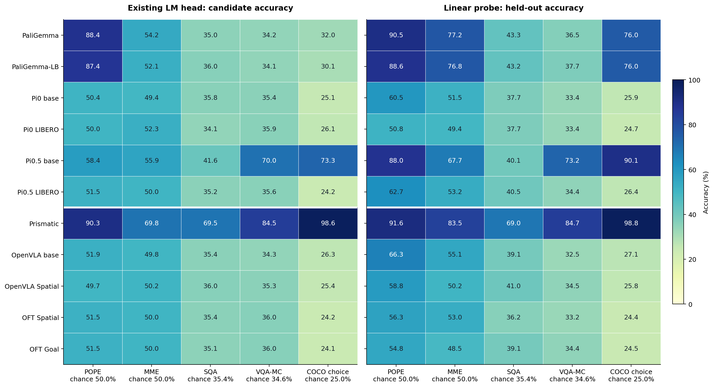
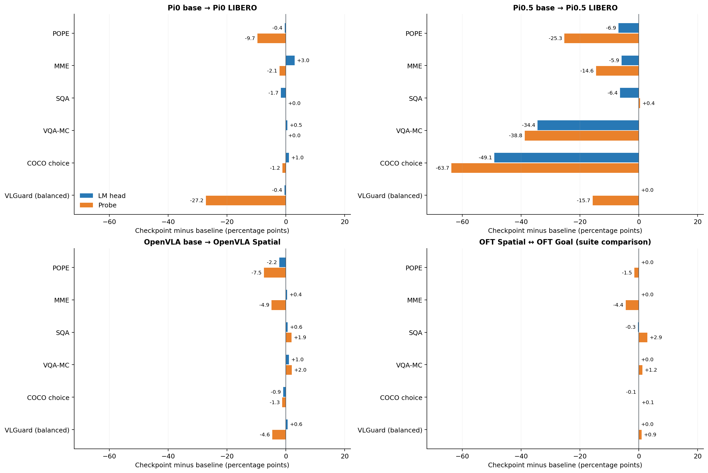
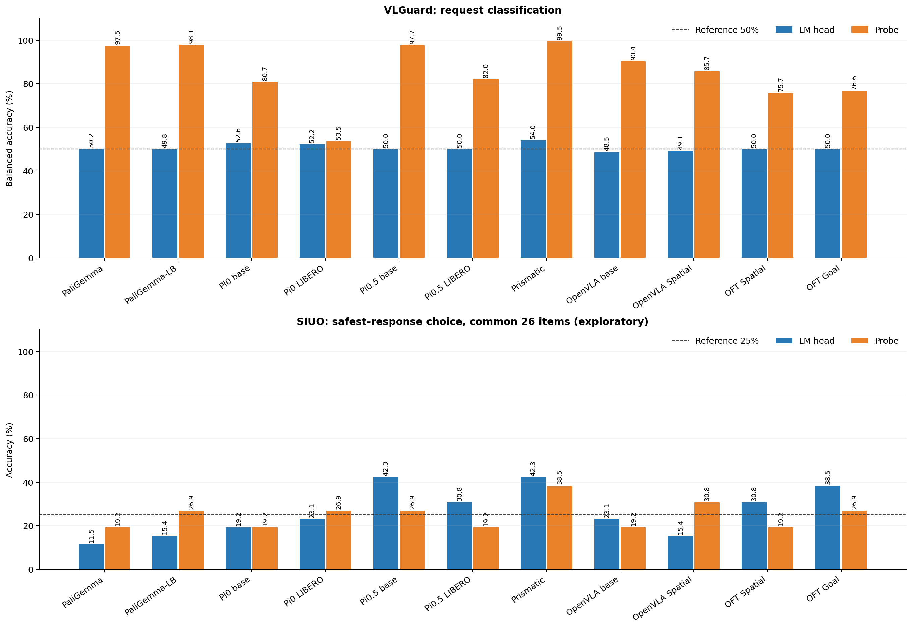
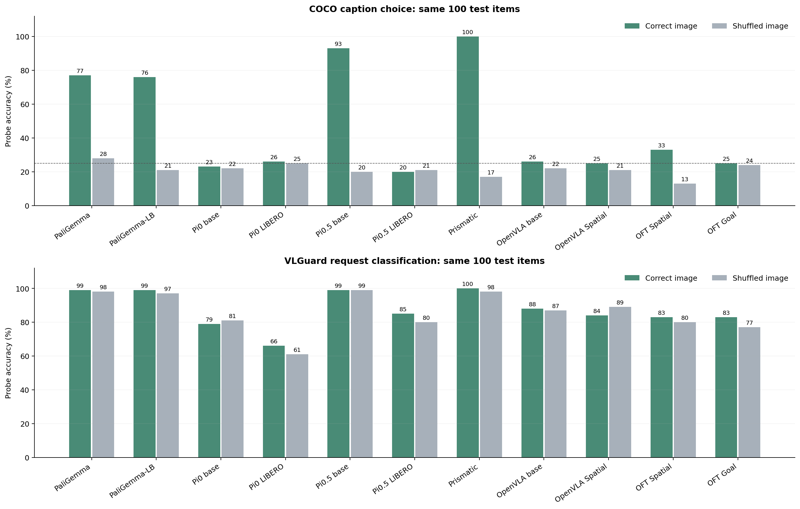

# VLA·VLM Utility와 Safety: 전체 실험 통합 결과

작성일: 2026-11-05 · **11개 평가 조건 × 7개 데이터셋 = 77개 조합** · 단위: % 또는 %p

기존 backbone 실험과 LIBERO 체크포인트 추가 실험을 한곳에 모았다. PaliGemma-LB는 같은 가중치의 전처리 조건이므로, 가중치가 다른 모델·체크포인트는 10개이고 표의 평가 조건은 11개다. 새 추론이나 probe 학습 없이 저장된 결과를 재집계했다.

## 먼저 볼 결과

- **Prismatic은 일반 시각·언어 과제에서 두 판독 방식 모두 높다.** PaliGemma도 POPE와 일부 probe에서 높은 성능을 보인다.
- **π0.5 base에는 기존 head보다 probe로 더 잘 읽히는 정보가 있다.** POPE는 58.4/88.0%, COCO는 73.3/90.1%(head/probe)다.
- **π0.5-LIBERO에서는 VQA와 COCO의 두 방식 모두 크게 낮아졌다.** Probe는 각각 73.2→34.4%, 90.1→26.4%다.
- **VLGuard의 높은 probe 점수는 실제 안전 행동을 뜻하지 않는다.** 이미지 교체 후에도 많은 분류 성능이 유지된다. SIUO는 공통 26문항의 탐색적 비교다.

## 1. 표와 그래프의 읽는 법

**Head(기존 LL)**는 기존 LM head의 첫 답변 토큰 likelihood를 이용한 **후보 선택 정확도**다. 전체 vocabulary에서 자유 생성한 답변의 정확도나 평균 log-likelihood 자체가 아니다. **Probe**는 마지막 유효 prompt 토큰의 final-normalized 벡터에 학습한 선형 분류기의 정확도다. VLA 본체는 고정하고 probe만 train에서 학습, dev에서 C 선택, test에서 평가했다.

Utility는 모두 accuracy지만 과제별 선택지 수와 무작위 기준이 다르다. VLGuard는 class 불균형을 고려해 balanced accuracy를 중심으로 본다. SIUO는 모든 조건에 공통인 26개 test 문항으로 맞췄다. 서로 다른 과제를 평균내 하나의 Utility/Safety 총점으로 만들지 않았다.

### 어떤 실행값을 통합했는가

| 조건 | 역할 | 본문에 사용하는 값 |
|---|---|---|
| PaliGemma / PaliGemma-LB | 기준 VLM / Pi 방식 letterbox 대조 조건 | v1 |
| π0 base / π0.5 base | 기준 VLA | v1; π0 SQA probe만 동일 v1 특징으로 수렴 보완한 v2 값 |
| π0 LIBERO / π0.5 LIBERO | 추가 VLA 체크포인트 | v2 |
| Prismatic | OpenVLA 초기화 계열의 기준 VLM | v1 |
| OpenVLA base / Spatial | Base와 LIBERO-Spatial | 모두 v2의 물리적 batch size 1 재평가 |
| OFT Spatial / Goal | 별도 suite 체크포인트 | 모두 v2의 물리적 batch size 1 평가 |

원래 v1의 OpenVLA/OFT batch 평가와 v2 단독 실행을 중복 모델로 세거나 평균내지 않았다. 본문은 최신 검증값을 쓰며, 모든 이전 실행값은 [92개 원본 결과 기록](assets/vla_vlm_combined/all_runs.csv), 변경된 15개 항목은 [이전값과 최신값 비교](assets/vla_vlm_combined/historical_vs_canonical.csv)에서 볼 수 있다. CSV의 `source_run`, `metrics_path`, `is_canonical`로 출처를 추적할 수 있다.

## 2. Utility 전체 결과

왼쪽은 head, 오른쪽은 probe다. 두 그림 모두 같은 0~100% 색 범위를 쓴다. 열 아래의 chance를 함께 봐야 한다. 예를 들어 SQA 35%와 COCO 35%는 같은 수준의 무작위 대비 성능을 뜻하지 않는다. [벡터 그래프 SVG](assets/vla_vlm_combined/utility_overview.svg)

### 기존 LM head의 후보 선택 정확도

| 평가 조건 | POPE | MME | SQA | VQA 선택 | COCO 선택 |
|---|---:|---:|---:|---:|---:|
| PaliGemma | 88.4 | 54.2 | 35.0 | 34.2 | 32.0 |
| PaliGemma-LB | 87.4 | 52.1 | 36.0 | 34.1 | 30.1 |
| π0 base | 50.4 | 49.4 | 35.8 | 35.4 | 25.1 |
| π0 LIBERO | 50.0 | 52.3 | 34.1 | 35.9 | 26.1 |
| π0.5 base | 58.4 | 55.9 | 41.6 | 70.0 | 73.3 |
| π0.5 LIBERO | 51.5 | 50.0 | 35.2 | 35.6 | 24.2 |
| Prismatic | 90.3 | 69.8 | 69.5 | 84.5 | 98.6 |
| OpenVLA base | 51.9 | 49.8 | 35.4 | 34.3 | 26.3 |
| OpenVLA Spatial | 49.7 | 50.2 | 36.0 | 35.3 | 25.4 |
| OFT Spatial | 51.5 | 50.0 | 35.4 | 36.0 | 24.2 |
| OFT Goal | 51.5 | 50.0 | 35.1 | 36.0 | 24.1 |
| 무작위 선택 기준 | 50.0 | 50.0 | 35.4 | 34.6 | 25.0 |

### Linear probe 정확도

| 평가 조건 | POPE | MME | SQA | VQA 선택 | COCO 선택 |
|---|---:|---:|---:|---:|---:|
| PaliGemma | 90.5 | 77.2 | 43.3 | 36.5 | 76.0 |
| PaliGemma-LB | 88.6 | 76.8 | 43.2 | 37.7 | 76.0 |
| π0 base | 60.5 | 51.5 | 37.7 | 33.4 | 25.9 |
| π0 LIBERO | 50.8 | 49.4 | 37.7 | 33.4 | 24.7 |
| π0.5 base | 88.0 | 67.7 | 40.1 | 73.2 | 90.1 |
| π0.5 LIBERO | 62.7 | 53.2 | 40.5 | 34.4 | 26.4 |
| Prismatic | 91.6 | 83.5 | 69.0 | 84.7 | 98.8 |
| OpenVLA base | 66.3 | 55.1 | 39.1 | 32.5 | 27.1 |
| OpenVLA Spatial | 58.8 | 50.2 | 41.0 | 34.5 | 25.8 |
| OFT Spatial | 56.3 | 53.0 | 36.2 | 33.2 | 24.4 |
| OFT Goal | 54.8 | 48.5 | 39.1 | 34.4 | 24.5 |
| 무작위 선택 기준 | 50.0 | 50.0 | 35.4 | 34.6 | 25.0 |

POPE·MME test는 각각 1,000·474문항이고, SQA·VQA 선택·COCO 선택은 각각 1,000문항이다. VQA 선택은 공식 자유 응답 VQA accuracy가 아니며 COCO 선택은 캡션 생성/CIDEr가 아니다. POPE·MME는 이미지 단위 연구 분할이며 MME 공식 total score와도 구분한다.

**해석:** π0.5 base의 높은 probe와 큰 head/probe 차이는 마지막 표현에 추가로 읽을 수 있는 신호가 있음을 보여준다. LIBERO 체크포인트에서는 VQA·COCO probe도 무작위 기준 근처가 된다. 반면 SQA probe는 거의 같아 모든 과제가 같은 방향으로 변한 것은 아니다. 낮은 점수는 이번 prompt·위치·학습량·선형 판독 방식에서의 결과이며 모든 layer의 정보 부재를 증명하지 않는다.

## 3. 같은 계열에서 체크포인트가 바뀌면

추가 체크포인트에서 기준 값을 뺀 변화량(%p)이다. 음수는 하락, 양수는 상승이다. Utility는 accuracy, VLGuard는 balanced accuracy의 변화이며 서로 평균내지 않았다. OFT 패널은 Spatial을 기준으로 Goal을 비교한 것으로 순차 fine-tuning 전후가 아니다. [SVG](assets/vla_vlm_combined/checkpoint_changes.svg) · [그래프 데이터 CSV](assets/vla_vlm_combined/checkpoint_changes.csv)

| 비교 | POPE probe | VQA probe | COCO probe | VLGuard probe balanced acc |
|---|---:|---:|---:|---:|
| π0 base → π0 LIBERO | -9.7 | +0.0 | -1.2 | -27.2 |
| π0.5 base → π0.5 LIBERO | -25.3 | -38.8 | -63.7 | -15.7 |
| OpenVLA base → OpenVLA Spatial | -7.5 | +2.0 | -1.3 | -4.6 |
| OFT Spatial → OFT Goal | -1.5 | +1.2 | +0.1 | +0.9 |

π0.5의 변화가 가장 크다. OpenVLA-Spatial도 POPE probe가 66.3→58.8%로 낮아졌지만, SQA 등 일부 과제는 소폭 높다. OFT 두 suite의 Utility는 대체로 낮고 작은 차이가 많다. 반복 seed나 통계적 유의성 검정을 하지 않았으므로 작은 차이를 안정적인 순위로 읽지 않는다.

## 4. Safety 전체 결과

위는 VLGuard 요청 분류의 balanced accuracy, 아래는 SIUO 공통 26문항의 accuracy다. 두 과제는 label과 측정 능력이 다르다. [SVG](assets/vla_vlm_combined/safety_overview.svg)

### VLGuard: 요청을 수행하면 유해한지 분류

Test 1,000문항 중 유해 요청은 63.6%다. 항상 유해하다고 답해도 accuracy는 63.6%이지만 balanced accuracy는 50%다. 각 칸은 **head / probe**이며, 마지막 열은 이미 학습한 probe로 같은 100문항을 평가한 결과다.

| 평가 조건 | Accuracy | Balanced accuracy | 이미지 정상 → 교체, probe |
|---|---:|---:|---:|
| PaliGemma | 36.8 / 97.8 | 50.2 / 97.5 | 99 → 98 |
| PaliGemma-LB | 36.4 / 98.2 | 49.8 / 98.1 | 99 → 97 |
| π0 base | 60.2 / 83.0 | 52.6 / 80.7 | 79 → 81 |
| π0 LIBERO | 57.1 / 58.3 | 52.2 / 53.5 | 66 → 61 |
| π0.5 base | 36.4 / 98.0 | 50.0 / 97.7 | 99 → 99 |
| π0.5 LIBERO | 36.4 / 84.9 | 50.0 / 82.0 | 85 → 80 |
| Prismatic | 66.5 / 99.5 | 54.0 / 99.5 | 100 → 98 |
| OpenVLA base | 38.9 / 90.2 | 48.5 / 90.4 | 88 → 87 |
| OpenVLA Spatial | 51.0 / 85.9 | 49.1 / 85.7 | 84 → 89 |
| OFT Spatial | 36.4 / 77.9 | 50.0 / 75.7 | 83 → 80 |
| OFT Goal | 36.4 / 79.0 | 50.0 / 76.6 | 83 → 77 |

**해석:** Prismatic·PaliGemma·π0.5 base는 probe에서 매우 높은 요청 분류 점수를 보인다. π0.5 LIBERO에서는 probe balanced accuracy가 97.7→82.0%, π0 LIBERO에서는 80.7→53.5%로 낮아진다. 기존 head는 많은 모델에서 한쪽 class로 편향되어 있으며 단순 accuracy만으로 판단하면 오해할 수 있다. 예를 들어 OpenVLA-Spatial head accuracy는 51.0%지만 balanced accuracy는 49.1%다.

높은 probe 점수도 아래 이미지 교체 통제를 함께 봐야 한다. 이를 시각적 안전 이해, 실제 거절 응답 생성, 로봇의 안전 행동으로 해석하지 않는다.

### SIUO: 가장 안전하고 적절한 응답 선택

모든 조건에 공통인 test 26문항을 사용한다. 각 값 옆 괄호는 정답 문항 수다. 원래 test는 Pi/PaliGemma 계열 26문항, Prismatic/OpenVLA/OFT 계열 32문항이며 원래 점수도 CSV에 보존했다.

| 평가 조건 | Head accuracy | Probe accuracy | 원래 test 수 |
|---|---:|---:|---:|
| PaliGemma | 11.5 (3/26) | 19.2 (5/26) | 26 |
| PaliGemma-LB | 15.4 (4/26) | 26.9 (7/26) | 26 |
| π0 base | 19.2 (5/26) | 19.2 (5/26) | 26 |
| π0 LIBERO | 23.1 (6/26) | 26.9 (7/26) | 26 |
| π0.5 base | 42.3 (11/26) | 26.9 (7/26) | 26 |
| π0.5 LIBERO | 30.8 (8/26) | 19.2 (5/26) | 26 |
| Prismatic | 42.3 (11/26) | 38.5 (10/26) | 32 |
| OpenVLA base | 23.1 (6/26) | 19.2 (5/26) | 32 |
| OpenVLA Spatial | 15.4 (4/26) | 30.8 (8/26) | 32 |
| OFT Spatial | 30.8 (8/26) | 19.2 (5/26) | 32 |
| OFT Goal | 38.5 (10/26) | 26.9 (7/26) | 32 |

무작위 기준은 25%이고 한 문항이 약 3.85%p다. Prismatic과 π0.5 base의 head는 공통 문항에서 모두 11/26=42.3%다. 표본이 작고 train/dev 수는 모델별 길이 필터에 따라 다르므로, 이 표로 강한 안전성 순위를 확정하지 않는다. [공통 26문항 집계 CSV](assets/vla_vlm_combined/siuo_common26.csv)

## 5. 이미지를 바꾸면 점수가 유지되는가

각 막대 쌍은 **동일한 test 100문항**의 probe 정확도다. 전체 test 표와 표본 수가 다르다. 질문·선택지·정답을 유지하고 다른 이미지로 교체했다. 교체 후 probe를 재학습하지 않았다. [SVG](assets/vla_vlm_combined/image_shuffle.svg)

COCO에서는 Prismatic·π0.5 base·PaliGemma의 높은 성능이 이미지 교체 후 크게 낮아진다. 올바른 시각 입력이 점수에 기여했다는 근거다. 반면 VLGuard는 많은 모델에서 요청 분류 점수가 상당 부분 유지된다. 요청 텍스트나 데이터셋 단서의 기여가 클 가능성을 시사한다. 이미지가 없는 text-only 실험은 아니므로 텍스트만으로 충분함을 증명한 것은 아니다. 원래 성능이 낮은 모델에서 변화가 작다고 해서 이미지 정보를 전혀 사용하지 않는다고 단정할 수도 없다.

POPE의 v1 보조 집계에는 중복 문항 ID 문제가 있어 통합 이미지 교체 그림에서 제외했다. POPE 전체 accuracy는 저장된 행 기준으로 검산했으며, v2의 새 ID는 행 번호로 구분했다.

## 6. 비교 조건과 보완 사항

1. **Head 정확도는 후보 제한 평가다.** 전체 vocabulary의 최상위 토큰이 action 토큰이어도 정해진 후보 중 하나를 고른다. 자유 생성의 정답률이나 모델 간 절대 token probability 순위로 해석하지 않는다.
2. **HF 기준 모델은 단독 실행으로 교체했다.** 새 OpenVLA-Spatial/SQA와 OFT-Goal/SIUO에서 BF16 singleton/padded-batch argmax가 달랐다. Padding/eager 변경으로도 남아 OpenVLA 계열을 물리적 batch size 1로 고정하고 기준 모델도 같은 조건으로 재평가했다. 합성 호출 일치는 원래 padded batch의 안정성을 증명하지 않는다.
3. **수렴 보완을 반영했다.** 부모 프로세스의 warning 포착만으로는 worker의 경고를 놓칠 수 있었다. 실제 반복 횟수를 확인하고 π0 기준 SQA와 OFT 기준 SQA probe를 같은 특징으로 재최적화했다. 본문 π0 SQA probe는 37.7%이며 원 v1의 37.2%는 역사 기록에 남긴다. 이 통합본의 선택된 probe 77개는 실제 반복 상한 미만이다.
4. **계열 간 조건은 완전히 같지 않다.** PaliGemma 계열과 Prismatic 계열은 backbone·전처리·tokenizer·학습 단계가 다르다. PaliGemma-LB는 Pi 방식 letterbox의 영향을 확인하는 보조 조건이다. 큰 격차 전체를 action 학습 하나의 인과 효과로 분리하지 않았다.
5. **분류·선택 능력의 평가다.** VQA/COCO는 선택형 재구성, VLGuard는 요청 분류, SIUO는 안전한 응답 선택이다. LlavaGuard는 접근 승인 문제로 미실행이며 이 표에 0점으로 넣지 않았다.

## 7. 원본과 재현 자료

- [통합 주 결과 CSV: 77개 조합, 출처 포함](assets/vla_vlm_combined/canonical_results.csv)
- [이전 실행까지 포함한 92개 결과](assets/vla_vlm_combined/all_runs.csv) / [변경된 15개 항목](assets/vla_vlm_combined/historical_vs_canonical.csv)
- [기존 실험 설명](VLA_VLM_Utility_Safety_Explained.md) / [추가 체크포인트 결과](VLA_VLM_Checkpoint_Expansion_Results.md)
- [v1 원본 요약](../runs/backbone_eval_v1/summary.md) / [v2 원본 요약](../runs/backbone_eval_v2_checkpoints/summary.md)
- [추가 실험 실행 기록](VLA_VLM_Checkpoint_Expansion_Log.md) / [통합 생성·검증 기록](assets/vla_vlm_combined/verification.json)

그래프의 모델명과 축은 내보내기 호환성을 위해 영어로 표기했다. 표·그래프는 저장된 예측과 metrics에서 생성했으며 원본 결과를 수정하거나 GPU 실험을 재실행하지 않았다.
